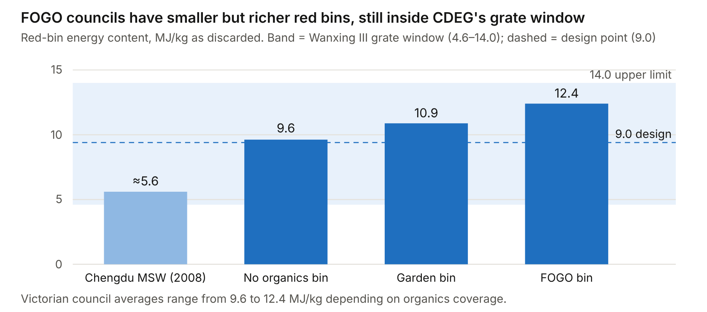
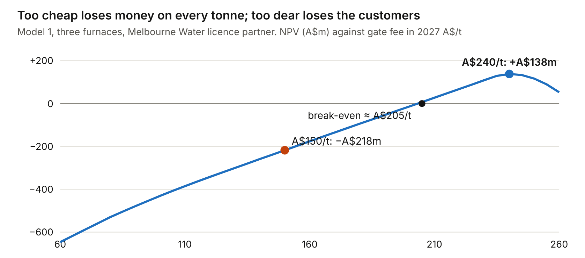
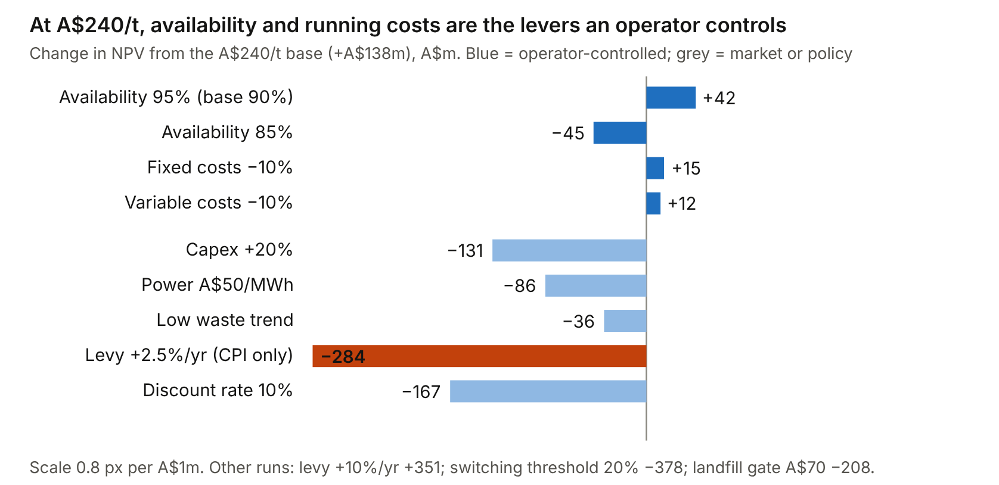

Owner: Kai负责人：马凯

::: {.en}
*Report draft 3, 25 Oct 2026. Reference numbers [n] refer to the [Sources](../appendix/sources.qmd) page.*
:::

::: {.zh}
*报告第三稿，2026年10月25日。方括号编号对应[资料来源](../appendix/sources.qmd)页。*
:::

## [Target licence holders]{.en}[目标许可持有方]{.zh}

::: {.en}
**Three licence holders are large enough for a two-line CDEG project. None is built, so the O&M opening is from about 2030–31.**

CDEG's minimum economic line is 500 t/d, and below 250 t/d is too small \[2\]. Its written answer adds that a project should have at least two lines (1,000–1,500 t/d), so the plant keeps running while one line is down \[3\]. A 500 t/d line handles about 165,000 t/yr at 90% availability.

**Table 3. Licence holders against CDEG's size test**

::: tw
  Holder (site)                  Cap t/yr   ≈ t/d   Technology                                                                           Status                                                                                            Fit
  ------------------------------ ---------- ------- ------------------------------------------------------------------------------------ ------------------------------------------------------------------------------------------------- -----------------------------------------------------------------------
  Cleanaway (Wollert)            760,000    2,080   Not announced; open technology EOI \[56\]                                            EPA application to be re-filed; EQT takeover by Mar 2027 \[32, 33\]                               High, if the new owner outsources O&M
  HiQ (Bulla, near Sunbury)      750,000    2,050   Grate, Kanadevia Inova (Appendix A)                                                  No planning approval; the Opposition pledged to scrap it \[57\]                                   High technically; highest political risk
  Melbourne Water (ETP or WTP)   450,000    1,230   Open; plant burning residual waste with waste heat drying sludge under study \[7\]   Feasibility 2026–31; private participation possible \[7\]; biosolids tender Mar–Jun 2025 \[58\]   Highest: matches CDEG's sludge co-firing \[2\]
  Recovered Energy Laverton      280,000    770     Gasification (Appendix A)                                                            Holds both licences; no start date or operator \[59\]                                             Conditional: below the two-line minimum; no gasification record \[2\]
:::

*Sources as cited; t/d = cap ÷ 365 \[Inferred\]. Liquid Power (50,000), Zerogen (45,000) and Knox (15,000) are each below one 250 t/d line \[1\]. Maryvale is not a target because Veolia operates it inside the consortium (Appendix A).*
:::

::: {.zh}
- 三家许可持有方符合集团两条线的规模要求：Cleanaway（76万吨）、HiQ（75万吨）、Melbourne Water（45万吨）。
- Recovered Energy Laverton（28万吨）为有条件目标。
- 均未开工，运营机会约在2030–31年。

::: {.placeholder}
完整中文译文待补充（英文版为准）。
:::
:::

## [Market size]{.en}[市场规模]{.zh}

::: {.en}
**Once built, Victoria's licensed plants would spend about A\$176m a year on operations. Allowing for political risk and owners who run their own plants, A\$45–91m is contestable. One contract would earn CDEG about A\$25–34m a year in revenue.**

**Formula.** Market value = tonnes processed × O&M value per tonne.

**O&M value per tonne.** This is what an owner pays an operator: staff, maintenance and consumables plus the operator's margin. Pre-sorting, ash disposal and reagents are treated as pass-through. In Model 1 these operator-controlled costs come to about A\$67/t at 90% availability: fixed costs of about A\$37/t plus A\$30/t variable \[26\]. Adding a 10–15% margin gives about A\$75/t \[Assumption\]. Metro Vancouver's contractor-run plant costs about C\$93–112/t (roughly A\$100–125) to operate, excluding ash and debt service \[74\] \[Industry\]. That is an older plant, at the top of our A\$60–110/t range. CDEG's own cost per tonne should replace this [to verify]{.verify}.

**Table 5. WtE O&M market in Victoria (annual, 2027 A\$, from about 2030)**

::: tw
  Layer               Definition                                                                                                     Mt/yr       At A\$75/t   Range
  ------------------- -------------------------------------------------------------------------------------------------------------- ----------- ------------ -------------
  TAM                 All cap-licensed tonnes                                                                                        2.35        A\$176m      A\$141–259m
  SAM                 Licences that pass CDEG's size test: Cleanaway, HiQ, Melbourne Water                                           1.96        A\$147m      A\$118–216m
  Risk-adjusted SAM   Without HiQ (political risk) = 1.21 Mt; half that if owners self-operate or take vendor-bundled O&M            0.60–1.21   A\$45–91m    A\$36–133m
  SOM (scenario)      One contract by about 2031: a two-line plant (2 × 500 t/d at 90% = 330,000 t) or Melbourne Water (450,000 t)   0.33–0.45   A\$25–34m    A\$20–50m
:::

*Sources: tonnes \[1\]; value per tonne \[26, 74\]. All values are \[Inferred\].*

The SOM is a scenario of winning one contract, and it is revenue, not profit. At a 10–15% operator margin it earns CDEG about A\$2.5–5.1m a year (6.6). Nationally, about 15 projects totalling around 4 Mt/yr are in development \[45\], worth about A\$300m a year at the same rate if all were built. That is upside, not the base case.
:::

::: {.zh}
- 计算公式：市场规模 = 处理量 × 每吨运营价值（基准75澳元/吨，范围60–110）。
- 总市场1.76亿澳元/年；可服务市场（三家许可）1.47亿澳元。
- 考虑风险后约0.45–0.91亿澳元；单个合同年收入约0.25–0.34亿澳元，按10–15%利润率计约250–510万澳元。

::: {.placeholder}
完整中文译文待补充（英文版为准）。
:::
:::

## [Waste composition and technical fit]{.en}[垃圾成分与技术适配]{.zh}

::: {.en}
**Victorian red-bin waste carries 9.6–12.4 MJ/kg, above Wanxing III's 9.0 MJ/kg design point but inside its 4.6–14 MJ/kg window. It is getting richer as FOGO takes food out.**

**How sorting works.** Victoria is moving to one statewide four-bin standard: general waste (red), mixed recycling (yellow), FOGO (lime) and glass (purple). The state sets the standard and the levy, and each council runs its own collection and disposal contracts \[34, 35\]. Only red-bin and commercial residual waste can go to WtE, and both must meet the permitted-waste rules in Table 2 \[36\]. Commercial loads need the most checking, because clean cardboard and deposit containers must be pulled out before the furnace. That is a sorting job for a local partner, since CDEG runs no general-waste sorting plant \[2\].

**Heating value.** Christine's comparison set Chinese household waste at about 3–6.7 MJ/kg against 9–11 MJ/kg for European residual waste \[75\]. Model 1 measures Victoria directly:

-   It applies NSW EPA red-bin audit compositions by organics service \[76\] to standard heating values for each material \[77\].
-   It weights the result by each Victorian council's organics coverage \[37\].

Red-bin waste carries about 9.6 MJ/kg where there is no organics bin, 10.9 MJ/kg with a garden bin, and 12.4 MJ/kg with FOGO \[26\] \[Inferred\].

Across all burnable waste landfilled, food fell 35% between 2015–16 and 2024–25 while plastics and paper rose. Average energy content climbed from 15.2 to 16.7 MJ/kg on a burnables-only basis. Total energy rose 21% while tonnes rose 11% \[26, 28\].

{fig-alt="Red-bin energy content by organics service against Wanxing III grate window"}

*Figure 3. Sources: \[3, 26, 76–78\]. The Chengdu value predates China's mandatory sorting.*

**What it means for CDEG.**

-   **Fewer tonnes per line.** A grate is limited by heat input. A line rated at 500 t/d on 9 MJ/kg waste takes only about 375–450 t/d at 10–12 MJ/kg \[Inferred\]. New Victorian plants will be rated for their own waste, but CDEG's 500 t/d minimum should be quoted in heat terms.
-   **A wide operating range.** FOGO pushes waste towards the 14 MJ/kg ceiling. Bromelton (Qld) is designed for 8.8–14.6 MJ/kg \[79\]. CDEG's experience is running varied waste, not one heating value.
-   **More plastic means more acid gas**, at the moment real-time public emissions reporting is coming (2.3).
-   **Fewer tonnes, but not less fuel.** Falling tonnes do not mean falling energy, which supports the power case. Shrinking tonnes still raise utilisation risk for owners (6.7).

CDEG says it needs no front-end sorting in China \[3\]. Victoria's permitted-waste rules make a sorting step necessary here, which is why the partner matters. Model 2 (waste-fit check, Janeika, in progress) will turn these inputs into a per-plant check against the grate window (Appendix E).
:::

::: {.zh}
- 维州红桶垃圾热值约9.6–12.4兆焦/千克，高于万兴三期设计值（9.0），但在其4.6–14兆焦/千克适应范围内。
- 实行FOGO后热值更高，同等热负荷下每条线处理吨数减少，塑料增加也带来更多酸性气体。

::: {.placeholder}
完整中文译文待补充（英文版为准）。
:::
:::

## [How the money flows and what it costs]{.en}[资金流向与成本]{.zh}

::: {.en}
**A Latrobe plant pays its way only at a gate fee of about A\$205–240/t and high load. Availability is the biggest lever an operator controls, although capex, price and the levy path swing value more.**

**Revenue stack.** Australian estimates put WtE revenue at about 60% gate fees, 25% electricity and 15% metals and other products \[45\]. Industry sources quote gate fees of A\$150–250/t \[45\]. Kwinana's contracted fee is about A\$120/t \[80\]. That was set against a WA levy of about A\$90/t, roughly half Victoria's, and Victoria's higher levy is what lets a plant here charge A\$205–240/t. Victoria's own regulatory modelling assumes A\$237/t and power at A\$80.11/MWh \[81\] (via Christine's 2.2). Only the biogenic share of waste earns renewable certificates \[82\]. Wholesale power has fallen sharply in 2026 \[83\], so the gate fee carries the project.

**Table 6. What Australia's two built plants teach**

::: tw
                         Kwinana (WA)                                                                                                                                                                               East Rockingham (WA)
  ---------------------- ------------------------------------------------------------------------------------------------------------------------------------------------------------------------------------------ --------------------------------------------------------------------------------------
  Capacity, technology   About 460,000 t/yr; Keppel Seghers grate, 2 lines                                                                                                                                          300,000 t/yr + 30,000 t biosolids; Kanadevia Inova grate
  Capital cost           Budget A\$680m; outturn reportedly over A\$1bn (above A\$2,170/t of capacity) \[45\]                                                                                                       A\$511m (about A\$1,700/t) \[45\]
  Finance and support    A\$275m equity (Macquarie, DIF) and about A\$400m debt including CEFC (up to A\$90m, since repaid); A\$23m ARENA grant \[45, 84, 85\]                                                      Bank debt with CEFC and ARENA \[84\]
  Offtake                Preferred renewable-power supplier to WA councils (WALGA) \[85\]                                                                                                                           Part supply to Talison Lithium's Greenbushes site \[86\]
  Waste supply           20-year council contracts (Rivers Regional Council, City of Kwinana) \[84\] [to verify]{.verify}                                                                                                       Waste-arising contracts, so councils can still cut waste
  Outcome                First waste July 2024, full operation December 2025 \[45\]. ACCIONA bought it in March 2024 and now owns and operates it; Veolia's long-term O&M contract ended in early 2025 \[85, 87\]   Receivership in October 2024; ACCIONA's bid withdrawn after ACCC concerns \[88, 89\]
  Lesson for CDEG        Owners and lenders most need on-time delivery and stable operation. Operators can be replaced, which is both an opening and a warning.                                                     
:::

*Compiled from Janeika's commercial-viability research (finance, supply, offtake), Christine's 5.2 (ACCIONA, ACCC) and Kai's market research (capex); sources as cited. Janeika's draft put Kwinana at 400,000 t and A\$668m; we use the larger reported capacity and outturn \[45\] [to verify]{.verify}.*

**Model 1.** The WtE payback model \[26\] follows a Latrobe Valley plant year by year from 2027, in four linked steps:

1.  **The licence sets the number of furnaces.** The default partner is Melbourne Water (450,000 t) plus the 150,000 t unallocated, so three 500 t/d furnaces.
2.  **The gate fee decides who sends waste.** Every council in Model 3 switches only if it saves at least 10%. Commercial waste from Melbourne is the rest of the supply.
3.  **That waste sets the load and the energy per tonne.**
4.  **Load against fixed costs decides payback.**

Defaults:

-   capex A\$830m (A\$200m site plus A\$210m per furnace); fixed costs A\$5m per furnace a year plus A\$3m site
-   A\$30/t variable cost and A\$15/t pre-sorting; 15% of input landfilled as ash at the metro price
-   power at A\$80/MWh and 20% net efficiency; landfill levy rising 5% a year
-   30% tax and an 8% nominal discount rate

{fig-alt="NPV against gate fee: negative below 205, peaking at 240 dollars per tonne"}

*Figure 4. Source: Model 1 \[26\], default settings, re-run for this report. Above about A\$240/t, councils and commercial customers return to landfill and the furnaces run part-empty.*

**What the model shows.**

-   **Price.** At A\$150/t, the plant fills easily: 81 councils in its first year (2030) plus commercial waste. But it loses money on every tonne (NPV −A\$218m, IRR 5.1%). Break-even is about A\$205/t. NPV peaks near A\$240/t (+A\$138m, IRR 9.6%, payback 10 years). At that price councils prefer landfill, and the plant runs at 89% on Melbourne commercial waste. A plant priced for profit therefore depends on commercial customers, not council contracts \[Inferred\].
-   **The licence is the binding constraint.** Without a partner's licence, only 150,000 t is available and the plant cannot pay (NPV −A\$99m). With HiQ's 750,000 t, five furnaces are allowed but run about half-empty at A\$240/t (NPV +A\$96m, below the three-furnace case).
-   **Policy can flip the answer.** If levy rises are only CPI (2.5% a year), NPV at A\$240/t falls to −A\$146m. Continued 10% rises lift it to +A\$489m.
-   **Market assumptions matter.** At a 20% switching threshold, NPV falls to −A\$240m; at a A\$70 landfill gate fee, to −A\$70m. Both are assumptions to test with councils (4.2).

{fig-alt="Sensitivity of NPV at 240 dollars per tonne"}

*Figure 5. Source: Model 1 \[26\], one input changed at a time, all others at defaults.*

**What it means for CDEG.** CDEG does not sell capex savings, because it buys its equipment \[2\]. What it sells is availability and running cost. Five points of availability are worth about A\$40–45m of NPV to the owner. A 10% cut in fixed costs, or in variable costs excluding pre-sorting, is worth A\$12–15m \[Inferred\]. These are the numbers to put in front of a licence holder (6.2).

**Limits.** Model 1 leaves out debt, LGC revenue, metals recovery, transfer-station capex and competition from other licence holders for the same waste. Its energy values are textbook figures and NSW audit compositions, not Victorian laboratory data \[26\]. Default costs are benchmarks to adjust until CDEG provides its own.
:::

::: {.zh}
- 收入约60%来自处理费、25%来自售电。
- 拉筹伯谷三炉方案的盈亏平衡处理费约205澳元/吨；约240澳元/吨时净现值最高（+1.38亿澳元，内部收益率9.6%）。
- 可用率每提高5个百分点，净现值约增加4000–4500万澳元，这是运营方能控制的杠杆。
- 资本支出、电价和填埋税走势的影响更大。

::: {.placeholder}
完整中文译文待补充（英文版为准）。
:::
:::

## [Siting under Australian conditions]{.en}[澳洲条件下的选址]{.zh} {#siting}

::: {.en}
The Latrobe Valley offers several former or closing coal sites:

-   Hazelwood, closed in 2017. Its rehabilitation EES was on exhibition until 2 November 2026, with a hearing in February 2027.
-   Yallourn, closing in mid-2028.
-   Loy Yang A, closing in 2035.

These sites have industrial land, terminal stations and power-station skills \[70–72\]. The valley has already approved Maryvale EfW \[73\]. The question is haul cost from Melbourne, about 150 km away. Our council price map (Model 3) answers it council by council \[26\]:

-   It prices delivery per sealed 20-foot container by road or rail, at about 17.5–22 t per box.
-   It counts a council as won only if our gate fee plus transport is at least 10% below its own landfill price.

At a gate fee of A\$150/t (2026–27 prices), 82 of 184 councils in Victoria, southern NSW, the ACT, Sydney and Adelaide would send their red-bin waste to Morwell: 1.97 Mt/yr. Another 25 councils are within 10% \[26\] \[Inferred\]. This is addressable supply, about four times a three-furnace plant, not demand the plant would take.

The levy, not distance, sets the reach. Councils in the 35-council metro levy zone (including Geelong, Ballarat and Bendigo) are reachable. Southern NSW councils outside the NSW levy area are not \[26, 31\]. Rail beats sea for every interstate council at current estimates.

So CDEG's 50 km rule of thumb gives way to "within the levy zone". A Latrobe hub is still a later-stage option. It needs a licence partner (the cap is the limit, not haul) and a gate fee above A\$205/t to pay its way (3.4).
:::

::: {.zh}
- 拉筹伯谷燃煤电厂旧址（Hazelwood、Yallourn、Loy Yang A）具备工业用地、变电站和电厂人才。
- 市政价格地图显示：在150澳元/吨处理费下，184个市政中有82个愿意把垃圾送到Morwell。
- 决定覆盖范围的是填埋税区，而不是50公里距离。
- 该方案需要许可伙伴，且处理费需高于约205澳元/吨，因此列为后续选项。

::: {.placeholder}
完整中文译文待补充（英文版为准）。
:::
:::

## [China vs Australia]{.en}[中澳对比]{.zh}

::: {.en}
See [Report 2.2](../report/market-context.qmd) and [Australia vs China regulation](../part-b/china-comparison.qmd).
:::

::: {.zh}
见[报告2.2](../report/market-context.qmd)及[中澳监管对比](../part-b/china-comparison.qmd)。
:::
