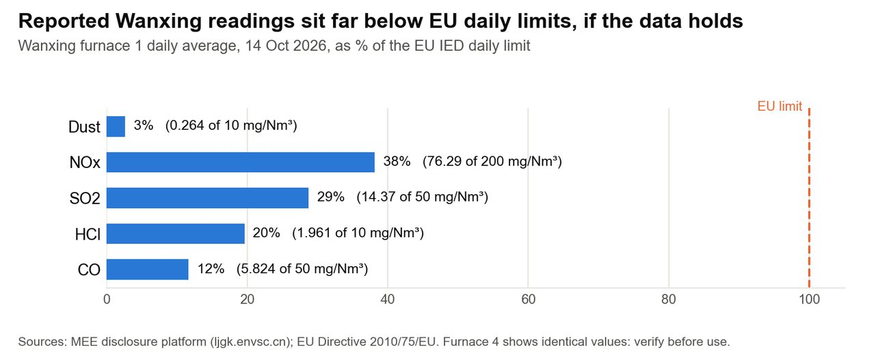

Author: Christine (Kuntong) Jiang作者：江坤彤

::: {.en}
*Report draft 3, 25 Oct 2026. Reference numbers [n] refer to the [Sources](../appendix/sources.qmd) page.*
:::

::: {.zh}
*报告第三稿，2026年10月25日。方括号编号对应[资料来源](../appendix/sources.qmd)页。*
:::

## [Emission standards]{.en}[排放标准]{.zh} {#emission-standards}

::: {.en}
**Table C1. Daily emission limits and Wanxing readings (mg/Nm³, 11% O₂, dry)**

::: tw
| Pollutant | GB 18485-2014 daily | EU IED daily | EU BAT-AEL, new plants | Wanxing, 14 Oct 2026 |
|---|---|---|---|---|
| Dust | 20 | 10 | \<2–5 | 0.264 |
| NOx | 250 | 200 | 50–120 | 76.29 |
| SO₂ | 80 | 50 | 5–30 | 14.37 |
| HCl | 50 | 10 | \<2–6 | 1.961 |
| CO | 80 | 50 | 10–50 | 5.824 |
| Mercury | 0.05 | 0.05 | 0.005–0.02 | not published daily |
| Dioxins (ng TEQ/Nm³) | 0.1 | 0.1 | \<0.01–0.04 | periodic tests; request |
:::

*Sources: \[23, 118–120\]. Wanxing values are furnace 1 daily averages for one day, taken from the MEE's WtE plant monitoring disclosure platform. They are a snapshot until the full hourly and annual series is available. EU limits are a benchmark here, not a Victorian legal limit \[46\].*

{fig-alt="Wanxing daily averages as a share of EU daily limits"}

*Figure C1. Wanxing daily averages as a share of EU daily limits (one day, furnace 1).*

**Why moisture and heating value matter.** Wet food waste lowers the usable heat per kilogram, because energy is spent evaporating water. A furnace is designed to burn waste steadily and completely, recover heat, limit pollutants, and avoid corrosion and slagging. Heating value is a key design input, but not the only one. In Victoria the issue reverses: drier, richer residual waste ([waste fit](../part-a/wte.qmd#waste-fit)) can push a grate towards its thermal limit.
:::

::: {.zh}
**表C1：日均排放限值与万兴数据（毫克/标准立方米，11% O₂，干基）**

::: tw
| 污染物 | GB 18485-2014日均值 | 欧盟IED日均值 | 欧盟BAT-AEL（新建电厂） | 万兴，2026年10月14日 |
|---|---|---|---|---|
| 颗粒物 | 20 | 10 | \<2–5 | 0.264 |
| 氮氧化物 | 250 | 200 | 50–120 | 76.29 |
| 二氧化硫 | 80 | 50 | 5–30 | 14.37 |
| 氯化氢 | 50 | 10 | \<2–6 | 1.961 |
| 一氧化碳 | 80 | 50 | 10–50 | 5.824 |
| 汞 | 0.05 | 0.05 | 0.005–0.02 | 未按日公开 |
| 二噁英（纳克TEQ/标准立方米） | 0.1 | 0.1 | \<0.01–0.04 | 定期检测；需向集团索取 |
:::

*来源：\[23, 118–120\]。万兴数据为1号炉单日的日均值，取自生态环境部生活垃圾焚烧发电厂自动监测数据公开平台。在取得完整的小时和年度数据之前，这只是一个快照。此处的欧盟限值是参照基准，而非维州的法定限值 \[46\]。*

{fig-alt="万兴日均排放占欧盟日均限值的比例"}

*图C1：万兴日均排放占欧盟日均限值的比例（单日，1号炉）。*

**为什么含水率和热值很重要：** 潮湿的厨余会降低每千克垃圾的可用热量，因为能量被用于蒸发水分。焚烧炉的设计目标是稳定、完全地燃烧垃圾，回收热量，控制污染物，并避免腐蚀和结渣。热值是关键设计参数，但不是唯一参数。在维州情况正好相反：更干、热值更高的剩余垃圾（[垃圾成分与技术适配](../part-a/wte.qmd#waste-fit)）可能把炉排推向其热负荷上限。
:::

## [Payment model and approvals]{.en}[收费模式与审批]{.zh}

::: {.en}
See [Report 2.2](../report/market-context.qmd) for how WtE is paid in China and Victoria.
:::

::: {.zh}
中澳收费模式对比见[报告2.2](../report/market-context.qmd)。
:::
