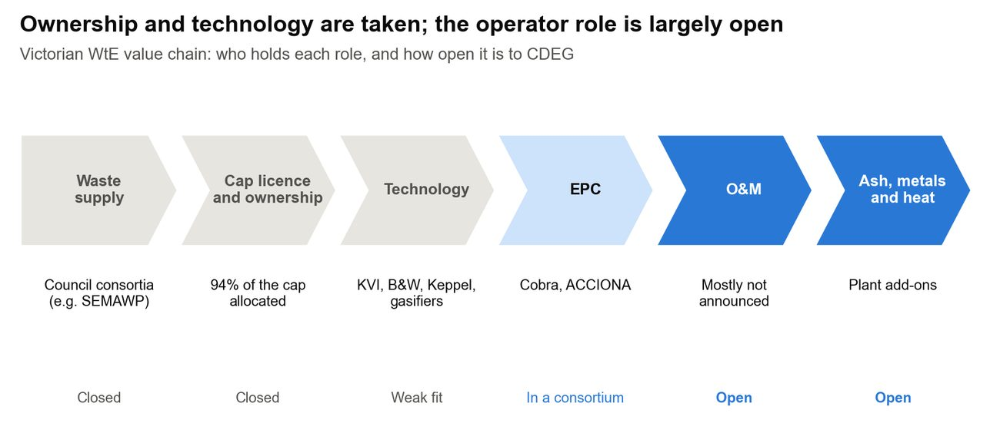
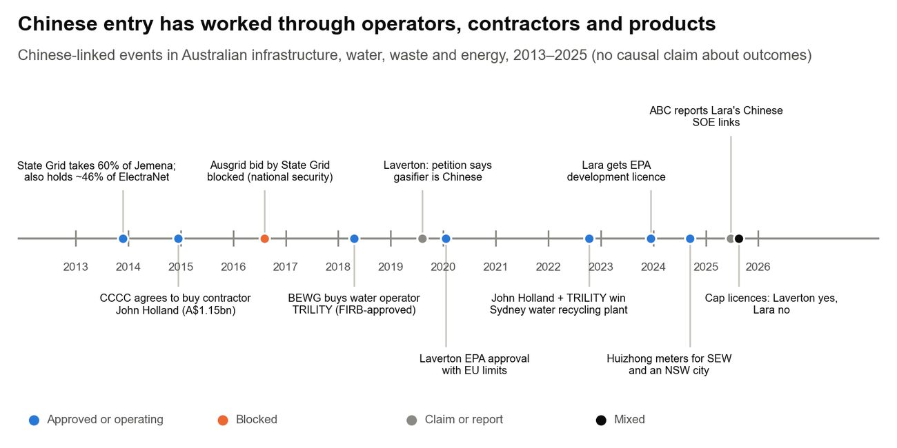

Authors: Christine (Kuntong) Jiang (5.1–5.3) · Janeika Jeyakanthan (5.2 meters and water, 5.4)作者：江坤彤（5.1–5.3）· Janeika Jeyakanthan（5.2水表与水务、5.4）

::: {.en}
*Report draft 3, 25 Oct 2026. Reference numbers [n] refer to the [Sources](../appendix/sources.qmd) page.*
:::

::: {.zh}
*报告第三稿，2026年10月25日。方括号编号对应[资料来源](../appendix/sources.qmd)页。*
:::

## [5.1 Value-chain role map]{.en}[5.1 价值链角色图]{.zh}

::: {.en}
**Ownership and technology are taken; the operator role is the one most often unannounced.**

{fig-alt="Victorian WtE value chain and roles open to CDEG"}

*Figure 8. Victorian WtE value chain and the roles open to CDEG. Sources: \[1, 88, 94\]; Appendix A.*

Waste supply, ownership and technology are closed to CDEG or a weak fit. EPC is open only inside a consortium. The operator role is unannounced at most licensed plants. That is an opening, not proof the role is open:

-   Where an operator has been named, it sits inside the ownership group. Veolia is a partner in the Maryvale consortium \[94\], and ACCIONA runs its own Kwinana plant (Table 6).
-   Furnace vendors can offer O&M with their grates \[Inferred\].

Who decides O&M, and when, is the first question to put to each licence holder (7.0). The full matrix is in Appendix A.
:::

::: {.zh}
**所有权和技术环节已被占据；运营方是最常尚未公布的角色。**

{fig-alt="维州焚烧发电价值链及集团可参与的角色"}

*图8：维州焚烧发电价值链及集团可参与的角色。来源：\[1, 88, 94\]；附录A。*

垃圾供应、所有权和技术环节对集团关闭或不适合集团。EPC只能在联合体内参与。多数获许可电厂尚未公布运营方。这是一个机会，但并不证明该角色空缺：

-   已公布运营方的项目，运营方都在业主联合体内部。Veolia是Maryvale联合体的合作方 \[94\]，ACCIONA自己运营Kwinana电厂（表6）。
-   焚烧炉供应商可以随炉排一起提供运营服务 \[推断\]。

谁决定运营安排、何时决定，是需要向每家许可持有方提出的第一个问题（第7节）。完整矩阵见附录A。
:::

## [5.2 Incumbents: waste-to-energy]{.en}[5.2 现有参与者：垃圾焚烧]{.zh}

::: {.en}
-   **Cleanaway, the national leader:** FY26 net revenue was A\$3.74bn (up 13.1%) and underlying EBIT A\$470m, from more than 350 sites and 9,700 staff \[95\]. It holds the 760,000 t/yr Wollert licence \[1\] but withdrew its EPA application in September 2025 to re-file \[32\]. In January 2026 it signed a joint development agreement for the 700,000 t/yr Parkes plant (NSW) with Tadweer, an Abu Dhabi state-owned waste operator, and Tribe \[96\]. Tadweer is itself a state-owned rival operator. On 18 October 2026 Cleanaway agreed to be bought by EQT Infrastructure for A\$3.095 a share, an enterprise value of about A\$9.3bn, with completion expected by March 2027 \[33\]. EQT owned EEW, Germany's largest WtE operator, until selling it to Beijing Enterprises in 2016 \[97\]. Wollert's technology and operator choices may now wait for the new owner \[Inferred\].
-   **Veolia, the operator with the widest reach:** It runs 68 water, wastewater and recycled-water plants in Australia, and in November 2025 it won A\$700m of water contracts, including six Central Highlands Water plants \[98\]. It is the operating partner in the Maryvale consortium \[73, 94\]. Its long-term Kwinana O&M contract ended in early 2025 \[87\]. Its Woodlawn plant (NSW) is under assessment \[99\].
-   **ACCIONA, the only WtE owner-operator:** It owns and operates Kwinana and is EPC contractor, creditor and 10% shareholder at East Rockingham (Table 6) \[88\].
-   **Others:** Remondis withdrew its A\$400m Swanbank plan in 2022 \[100, 101\]. Visy holds an existing-operator licence at Coolaroo \[1\]. Vendors with Australian references are Kanadevia Inova (HiQ, Parkes), Keppel (Kwinana) and Babcock & Wilcox (Maryvale) \[45, 94, 102\].

The operating market is thin. One large plant runs, one is in receivership, and Victoria's plants start from about 2030. None of the large licence holders has named an operator, so CDEG's opening is O&M or technical services; each holder's pros and cons are in [Table 3a](../part-a/wte.qmd) \[Inferred\].
:::

::: {.zh}
-   **Cleanaway，全国龙头：** 2026财年净收入37.4亿澳元（增长13.1%），基础息税前利润4.70亿澳元，拥有350多个场所和9,700名员工 \[95\]。持有76万吨/年的Wollert许可 \[1\]，但于2025年9月撤回EPA申请以便重新提交 \[32\]。2026年1月，与阿布扎比国有废物运营商Tadweer及Tribe签署了70万吨/年Parkes电厂（新州）的联合开发协议 \[96\]。Tadweer本身就是一家国有竞争运营商。2026年10月18日，Cleanaway同意以每股3.095澳元被EQT Infrastructure收购，企业价值约93亿澳元，预计2027年3月前完成 \[33\]。EQT曾拥有德国最大的焚烧运营商EEW，2016年将其出售给北京控股 \[97\]。Wollert的技术和运营方选择现在可能要等新业主决定 \[推断\]。
-   **Veolia，覆盖最广的运营商：** 在澳洲运营68座供水、污水和再生水厂，2025年11月赢得7亿澳元的水务合同，包括中部高地水务的六座水厂 \[98\]。它是Maryvale联合体的运营伙伴 \[73, 94\]。其Kwinana长期运营合同于2025年初结束 \[87\]。其Woodlawn电厂（新州）正在审批中 \[99\]。
-   **ACCIONA，唯一的焚烧电厂业主兼运营方：** 拥有并运营Kwinana，并且是East Rockingham的EPC承包商、债权人和10%股东（表6）\[88\]。
-   **其他：** Remondis于2022年撤回了4亿澳元的Swanbank计划 \[100, 101\]。Visy在Coolaroo持有既有运营商许可 \[1\]。在澳洲有业绩的设备供应商包括Kanadevia Inova（HiQ、Parkes）、Keppel（Kwinana）和Babcock & Wilcox（Maryvale）\[45, 94, 102\]。

运营市场很薄：一座大型电厂在运营，一座处于破产接管，维州的电厂约从2030年起才投运。几家大型许可持有方均未指定运营方，因此集团的机会在于运营或技术服务；各持有方的利弊见[表3a](../part-a/wte.qmd) \[推断\]。
:::

## [5.2 Incumbents: meters and water]{.en}[5.2 现有参与者：水表与水务]{.zh}

::: {.en}
**Chinese meters already hold Australian approvals and the big metro contracts, so CDEG competes on integration and leak analytics, not on price alone.**

-   **Huizhong, through Avnet:** supplies South East Water's digital meter program \[10, 65\]. Avnet is its exclusive agent and runs a meter test lab in Melbourne \[27\]. Huizhong also won a 2024 contract worth about US\$140m to supply an Australian city \[11\].
-   **Sanchuan and Ningbo Water Meter:** both hold NMI certificates of approval (14/3/70 and 14/3/22) \[9\].
-   **Landis+Gyr:** holds NMI approval 14/3/72 \[9\] and won a major South East Water smart-water contract in 2021 \[103\].
-   **Sagemcom:** Yarra Valley Water's digital meter supplier \[66\].
-   **Iota (Lentic platform):** Barwon Water's data and IoT platform partner \[67, 90\]. A new meter has to report into platforms like this, so Iota is a channel as much as a rival.
-   **Water O&M:** Veolia runs 68 water, wastewater and recycled-water plants and won A\$700m of contracts in November 2025 \[98\]. TRILITY (BEWG) runs the Adelaide Desalination Plant and the Barwon biosolids dryer, and is part of the Upper South Creek team \[61, 104, 105\].

**So what for CDEG.** Three Chinese meter makers are ahead on approvals. CDEG's meter needs a reason beyond price: NB-IoT meters plus drainage sensors and leak analytics from one supplier, proven on a utility's own platform. In water and biosolids O&M, TRILITY is both the closest rival and a possible partner (5.3).
:::

::: {.zh}
**中国水表已取得澳洲认证并拿下墨尔本大型合同，因此集团应凭借系统集成和漏损分析竞争，而不能只靠价格。**

-   **汇中（经Avnet）：** 为东南水务的数字水表项目供货 \[10, 65\]。Avnet是其独家代理，并在墨尔本设有水表检测实验室 \[27\]。汇中还于2024年赢得约1.4亿美元的澳洲城市供货合同 \[11\]。
-   **三川和宁波水表：** 均已取得NMI型式批准证书（14/3/70和14/3/22）\[9\]。
-   **Landis+Gyr：** 持有NMI批准14/3/72 \[9\]，2021年赢得东南水务的大型智能水务合同 \[103\]。
-   **Sagemcom：** 雅拉谷水务的数字水表供应商 \[66\]。
-   **Iota（Lentic平台）：** Barwon Water的数据与物联网平台合作方 \[67, 90\]。新水表必须向此类平台传输数据，因此Iota既是竞争者，也是渠道。
-   **水务运营：** Veolia运营68座供水、污水和再生水厂，2025年11月赢得7亿澳元合同 \[98\]。TRILITY（北控水务）运营阿德莱德海水淡化厂和Barwon生物固体干化设施，并参与Upper South Creek项目 \[61, 104, 105\]。

**对集团的意义：** 三家中国水表厂商在认证上已经领先。集团的水表需要价格之外的理由：由同一供应商提供NB-IoT水表、排水传感器和漏损分析，并在水务公司自己的平台上验证。在水务和生物固体运营领域，TRILITY既是最接近的竞争者，也是可能的合作伙伴（5.3）。
:::

## [5.3 Chinese SOEs in Australia: case learning]{.en}[5.3 中国国企在澳案例]{.zh}

::: {.en}
**Chinese SOEs have entered as service operators beside local partners; bids for control of critical assets have been refused.**

{fig-alt="Chinese-linked events in Australian infrastructure"}

*Figure 9. Chinese-linked events in Australian infrastructure, water, waste and energy. Sources: \[14, 15, 55, 59, 92, 93, 104–110\].*

Chinese state-owned firms have entered Australian infrastructure in three ways. In these few cases, service businesses under Australian management have met less resistance than bids for control. That is an observation, not a rule.

-   **BEWG and TRILITY, water operations (reference value: high).** Beijing Enterprises Water bought 100% of TRILITY with FIRB approval in 2018 \[14\]. TRILITY kept its Australian name and team, and operates the Adelaide Desalination Plant through the AdelaideAqua joint venture until 2033 \[104\]. With John Holland, GHD and Jacobs it won Sydney Water's Upper South Creek plant \[105\]. Its WA Helena Water purchase was approved but publicly criticised by the state water minister \[111\]. For CDEG, also a city-owned group, this is the closest model, but approval brings political attention.
-   **CCCC and John Holland, construction (medium).** CCCC bought John Holland in 2014 for A\$1.15bn \[106\]. John Holland lost A\$117m in its latest year after fixed-price write-downs \[107\]. That supports CDEG's preference for O&M over EPC risk.
-   **State Grid, energy networks (low for control).** State Grid holds 60% of Jemena beside Singapore Power \[108, 109\] and about 46% of ElectraNet \[110\]. Its 2016 bid for control of Ausgrid was blocked \[15\]. Minority stakes beside non-Chinese co-owners were approved; control was refused. SOCI duties now apply to critical asset owners and their contractors (2.3).
-   **WtE precedents (medium).** Lara is the one Victorian proposal with a named major Chinese WtE firm: Everbright as technology partner and a CEEC institute as designer \[92\]. It holds an EPA development licence but missed out on a cap licence, and has no planning permit or confirmed finance \[1, 92, 93\]. Laverton North's gasifier supplier is unnamed \[1, 59\]. The lesson is to partner with a funded licence holder, not a small developer.

**Partner logic.** CDEG should bid with Australian or other non-Chinese partners, such as a local waste company and an engineering firm, and keep any equity small. A partner that is also Chinese-owned would not address ownership questions. TRILITY is still worth approaching in water and biosolids, where it is both a possible ally and the closest rival \[61\] \[Inferred\].
:::

::: {.zh}
**中国国企以服务运营商身份、与本地伙伴共同进入澳洲；控股关键资产的收购则被拒绝。**

{fig-alt="澳洲基础设施领域与中国相关的事件"}

*图9：澳洲基础设施、水务、废物和能源领域与中国相关的事件。来源：\[14, 15, 55, 59, 92, 93, 104–110\]。*

中国国有企业以三种方式进入澳洲基础设施领域。在这几个案例中，由澳洲团队管理的服务业务遇到的阻力小于控股收购。这是观察，而非规律。

-   **北控水务与TRILITY，水务运营（参考价值：高）。** 北控水务于2018年经FIRB批准收购TRILITY 100%股权 \[14\]。TRILITY保留了澳洲品牌和团队，通过AdelaideAqua合资公司运营阿德莱德海水淡化厂至2033年 \[104\]。它与John Holland、GHD和Jacobs共同赢得悉尼水务Upper South Creek水厂项目 \[105\]。其收购西澳Helena Water获得批准，但受到州水务部长的公开批评 \[111\]。集团同为市属企业集团，这是最接近的模式，但获批也会带来政治关注。
-   **中国交建与John Holland，建筑施工（中）。** 中国交建于2014年以11.5亿澳元收购John Holland \[106\]。John Holland最近一年因固定总价合同减值亏损1.17亿澳元 \[107\]。这支持集团倾向运营服务、规避EPC风险的选择。
-   **国家电网，能源网络（控股：低）。** 国家电网与新加坡电力共同持有Jemena 60%股权 \[108, 109\]，并持有ElectraNet约46%股权 \[110\]。其2016年对Ausgrid的控股收购被否决 \[15\]。与非中资共同持有的少数股权获批，控股则被拒绝。现在，关键资产的所有者及其承包商须承担SOCI义务（2.3）。
-   **焚烧发电先例（中）。** Lara是维州唯一点名中国大型焚烧企业的项目：光大环境为技术合作方，中国能建下属设计院为设计方 \[92\]。该项目持有EPA开发许可，但未获配额许可，也没有规划许可或确定的融资 \[1, 92, 93\]。Laverton North的气化设备供应商未公开 \[1, 59\]。教训是要与资金到位的许可持有方合作，而不是与小型开发商合作。

**合作逻辑：** 集团应与澳洲或其他非中资伙伴（如本地废物企业和工程公司）共同投标，并保持小比例股权。同为中资的伙伴无法化解所有权方面的疑虑。在水务和生物固体领域，TRILITY仍值得接触，它既可能是盟友，也是最接近的竞争对手 \[61\] \[推断\]。
:::

## [5.4 Positioning map and Five Forces]{.en}[5.4 定位图与五力分析]{.zh}

::: {.en}
**Five Forces for WtE O&M in Victoria: buyers hold the power, and vendors and owners can shut the operator out. CDEG's leverage is proven availability.**

::: tw
| Force | Strength | Why |
|---|---|---|
| Buyer power (licence holders) | High | Only three licence holders fit CDEG's size, and each will run one tender or none (Table 3) |
| Vendor bundling (supplier power) | High | Grate vendors can offer O&M with their furnaces; Kanadevia Inova is HiQ's vendor (5.2) |
| Rivalry among operators | Medium | Veolia and ACCIONA have Australian plants; the market is thin until about 2030 (5.2) |
| Threat of entrants | Medium | Other Chinese and international operators are looking abroad (2.2); Tadweer is partnering with Cleanaway in NSW \[96\] |
| Substitutes | Medium, falling | Landfill is the substitute, but the levy rises every year (2.1) |
:::

The forces favour an operator that can show lower cost and higher availability with a guarantee, inside a consortium a vendor or owner will accept (6.2).

::: {.placeholder}
- Positioning map: Australian/OECD track record × expected cost per tonne (needs cost-per-tonne data for CDEG and rivals)
:::
:::

::: {.zh}
**维州焚烧运营的五力分析：买方议价能力强，设备商和业主都可能把运营方排除在外。集团的筹码是经过验证的可用率。**

::: tw
| 竞争力量 | 强度 | 原因 |
|---|---|---|
| 买方议价能力（许可持有方） | 高 | 只有三家许可持有方符合集团规模，每家最多一次招标（表3） |
| 设备商捆绑（供应商议价能力） | 高 | 炉排供应商可随设备提供运营；Kanadevia Inova是HiQ的设备商（5.2） |
| 现有运营商竞争 | 中 | Veolia和ACCIONA在澳洲有电厂；2030年前市场很薄（5.2） |
| 新进入者威胁 | 中 | 其他中国及国际运营商正在出海（2.2）；Tadweer正与Cleanaway在新州合作 \[96\] |
| 替代品 | 中，正在下降 | 填埋是替代品，但填埋税逐年上涨（2.1） |
:::

这些力量有利于能够以担保证明更低成本和更高可用率、并处于设备商或业主认可的联合体中的运营方（6.2）。

::: {.placeholder}
- 定位图：澳洲/OECD业绩 × 预计每吨成本（需集团及竞争对手的吨成本数据）
:::
:::
