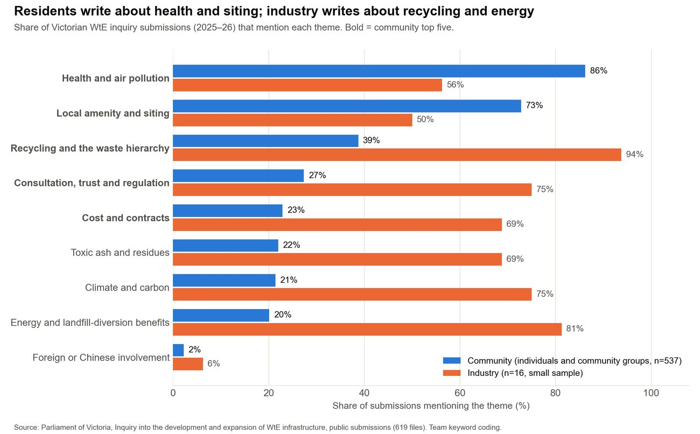
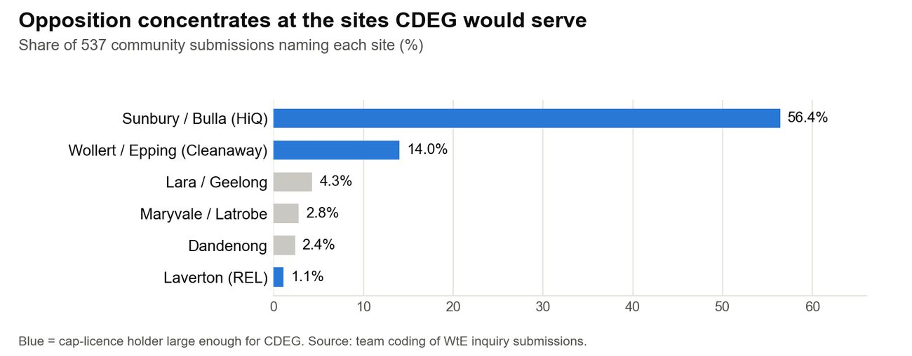

Authors: Janeika Jeyakanthan (4.1–4.3) · Christine (Kuntong) Jiang (4.4)作者：Janeika Jeyakanthan（4.1–4.3）· 江坤彤（4.4）

::: {.en}
*Report draft 3, 25 Oct 2026. Reference numbers [n] refer to the [Sources](../appendix/sources.qmd) page.*
:::

::: {.zh}
*报告第三稿，2026年10月25日。方括号编号对应[资料来源](../appendix/sources.qmd)页。*
:::

::: {.en}
We have no interviews yet, so each persona is built from what the customer has published: inquiry submissions, ASX and EPA records, and price submissions. Each one is a hypothesis to test in the first 90 days (7).
:::

::: {.zh}
我们尚未开展访谈，因此每个客户画像都基于客户公开发布的资料：议会调查意见、澳交所和EPA记录以及价格申报。每个画像都是需要在前90天内检验的假设（第7节）。
:::

## [4.1 Persona: licence-holder project director]{.en}[4.1 客户画像：许可持有方项目总监]{.zh}

::: {.en}
::: {.placeholder}
- Cleanaway, HiQ, Melbourne Water: project stage, decision-makers, fears (overruns, unproven operator, opposition), what they value, how they buy
:::
:::

::: {.zh}
::: {.placeholder}
- Cleanaway、HiQ、Melbourne Water：项目阶段、决策者、顾虑（超支、运营方无业绩、社区反对）、关注点、采购方式
:::
:::

## [4.2 How WtE buyers decide]{.en}[4.2 焚烧项目买方如何决策]{.zh}

::: {.en}
::: {.placeholder}
- Owner, lenders' technical adviser, EPA, councils (20–25-year supply contracts), community; test the 10% switching threshold with councils
:::
:::

::: {.zh}
::: {.placeholder}
- 业主、贷款方技术顾问、EPA、市政（20–25年供应合同）、社区；与市政检验10%的转换门槛
:::
:::

## [4.3 Persona: regional water corporation]{.en}[4.3 客户画像：区域水务公司]{.zh}

::: {.en}
::: {.placeholder}
- Budget cycle (2028 Water Price Review), tenders and joint tenders, NMI/WaterMark requirements, leak detection, platform integration (Iota Lentic), IWN pilots
:::
:::

::: {.zh}
::: {.placeholder}
- 预算周期（2028年水价审查）、招标与联合招标、NMI/WaterMark要求、漏损检测、平台集成（Iota Lentic）、IWN试点
:::
:::

## [4.4 Public sentiment]{.en}[4.4 公众态度]{.zh}

::: {.en}
**Opposition is about health and siting, it is concentrated at HiQ's Sunbury site, and it has not yet focused on Chinese involvement.**

A WtE plant in Victoria needs community acceptance as well as a licence, and an operator inherits the plant's reputation. Without interviews, submissions to the parliamentary inquiry are the public record of what residents and industry think. This section answers two questions: what residents fear most, and whether Chinese involvement adds to it.

We coded 565 readable submissions to the inquiry \[6\]: 537 from individuals and community groups, 16 from industry and 12 from other submitter types. Health and air pollution is the leading community concern: 86% of community submissions use at least one health keyword. It is followed by local amenity and siting (73%), recycling and the waste hierarchy (39%), consultation, trust and regulation (27%), and cost and contracts (23%). Industry argues in other terms: recycling and the waste hierarchy (94%) and the energy and landfill-diversion benefits of WtE (81%).

{fig-alt="Themes in WtE inquiry submissions, community vs industry"}

*Figure 6. Themes in WtE inquiry submissions, community vs industry. Source: \[6\], team coding (method above).*

Opposition is local. 56% of community submissions name Sunbury or Bulla (HiQ), and 14% name Wollert, Epping or Donnybrook (Cleanaway). Chinese involvement is rarely raised: 4 of 537 community submissions express concern about foreign ownership, 3 cite Chinese plants as emissions evidence, 2 cite China as a positive example, and 3 mention it in other ways. No Chinese operator has yet been named at any licensed site, so the low count does not show how residents would react to one. Lara, the one Victorian proposal linked to a Chinese WtE firm, drew strong local opposition \[92, 93\].

{fig-alt="WtE sites named in community submissions"}

*Figure 7. WtE sites named in community submissions. Source: \[6\].*

Water meters draw little debate. 177 posts in 13 Whirlpool threads (2011–2026) are mostly practical:

-   installation: 42%
-   leaks and usage data: 39%
-   bills: 14%
-   privacy: 6%

The barrier for meters is utility procurement and approval, not public acceptance.

**So what.** An O&M partner at HiQ or Cleanaway inherits this opposition. CDEG's offer should lead with independently verified emissions and live public data, then truck and siting management (6.2). These are self-selected submissions, mostly from opponents, so they show what concerned people say, not what all Victorians think.
:::

::: {.zh}
**反对意见集中在健康和选址，主要针对HiQ的Sunbury场址，目前尚未聚焦于中资参与。**

在维州，焚烧电厂除了许可之外还需要社区接受，运营方会继承电厂的声誉。在没有访谈的情况下，向议会调查提交的意见是反映居民和行业看法的公开记录。本节回答两个问题：居民最担心什么，以及中资参与是否会加重这种担心。

我们对调查收到的565份可读意见进行了编码 \[6\]：537份来自个人和社区团体，16份来自行业，12份来自其他类型提交者。健康与空气污染是社区最主要的关切：86%的社区意见至少使用了一个与健康相关的关键词。其次是当地环境与选址（73%）、回收与废物处理层级（39%）、公众参与、信任与监管（27%），以及成本与合同（23%）。行业则从其他角度论证：回收与废物处理层级（94%），以及焚烧发电在能源和减少填埋方面的好处（81%）。

{fig-alt="焚烧发电调查意见主题：社区与行业对比"}

*图6：焚烧发电调查意见主题，社区与行业对比。来源：\[6\]，团队编码（方法见上文）。*

反对是地方性的。56%的社区意见点名Sunbury或Bulla（HiQ），14%点名Wollert、Epping或Donnybrook（Cleanaway）。中资参与很少被提及：537份社区意见中，4份表达对外国所有权的担忧，3份以中国电厂作为排放问题的证据，2份以中国为正面例子，另有3份以其他方式提及。由于目前没有任何获许可场址点名中资运营方，这一低数字并不能说明居民对中资运营方会作何反应。Lara是维州唯一一个与中国焚烧企业有关的项目，曾遭到当地强烈反对 \[92, 93\]。

{fig-alt="社区意见中点名的焚烧项目场址"}

*图7：社区意见中点名的焚烧项目场址。来源：\[6\]。*

水表引发的讨论很少。Whirlpool论坛13个帖子（2011–2026年）中的177条留言大多是实际问题：

-   安装：42%
-   漏损与用水数据：39%
-   账单：14%
-   隐私：6%

水表的障碍在于水务公司的采购和审批，而不是公众接受度。

**对集团的意义：** 在HiQ或Cleanaway担任运营伙伴，就会继承这些反对意见。集团的方案应首先提供经独立核实的排放数据和实时公开数据，其次是运输车辆和场址管理（6.2）。这些意见是自愿提交的，大多来自反对者，因此反映的是关切者的说法，而不是全体维州居民的看法。
:::
