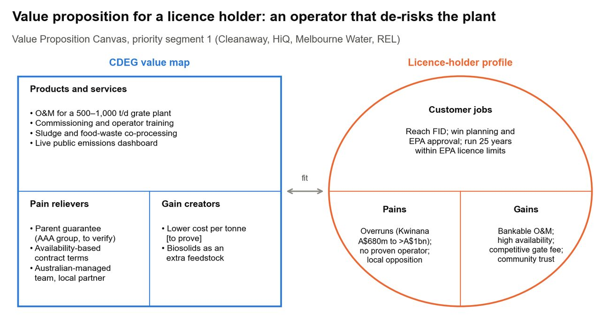
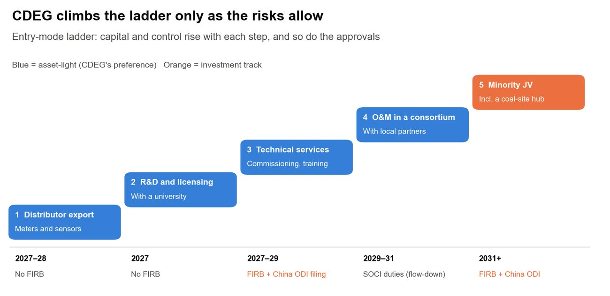
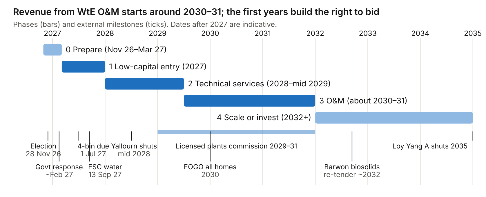
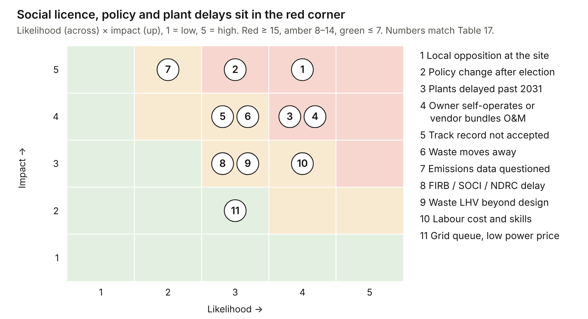

Authors: Janeika Jeyakanthan (6.1, 6.4) · Christine (Kuntong) Jiang (6.2, 6.3) · Kai Marsh (6.5–6.7) · whole team (7)作者：Janeika Jeyakanthan（6.1、6.4）· 江坤彤（6.2、6.3）· 马凯（6.5–6.7）· 全体成员（7）

::: {.en}
*Report draft 3, 25 Oct 2026. Reference numbers [n] refer to the [Sources](../appendix/sources.qmd) page.*
:::

::: {.zh}
*报告第三稿，2026年10月25日。方括号编号对应[资料来源](../appendix/sources.qmd)页。*
:::

## [6.1 Priority segments]{.en}[6.1 优先细分市场]{.zh}

::: {.en}
**Three segments, in the order CDEG can start them: water corporations and organics processors now, licence holders from about 2030. Investment options wait for a licence partner.**

::: tw
| Segment | Who | What CDEG sells | Revenue starts | Why |
|---|---|---|---|---|
| **1. WtE licence holders** | Cleanaway, HiQ, Melbourne Water; Recovered Energy Laverton conditional (pros and cons in Table 3a) | O&M in a consortium; operations-readiness and commissioning advice | Services 2028–29; O&M about 2030–31, 2032 downside (6.5) | Largest value: A\$45–91m a year contestable (3.2). Slowest and most political (4.4) |
| **2. Water corporations** | Melbourne Water (biosolids); 13 regional corporations (meters, sensors) | Sludge drying and co-firing services; NB-IoT meters, leak analytics and drainage sensors | Proposals 2027; meter sales after NMI approval, about mid-2028 (3.2) | No cap licence needed; 167,000 t of biosolids landfilled (Table 4); price submissions due 13 Sep 2027 \[13\] |
| **3. Organics processors and councils** | Processors such as Repurpose It; councils rolling out FOGO | Decontamination equipment and a pilot | Pilot 2027 | 437,000 t of food landfilled; the state names decontamination as an investment gap \[29\] |
:::

**Later-stage options, not yet segments:** technology introduction, minority co-investment and a Latrobe coal-site hub. Each opens only when a licence partner, policy and approvals line up. The hub also needs a gate fee above about A\$205/t (3.4).

::: {.placeholder}
- Weighted scoring of entry options (demand 25%, fit 25%, economics 25%, partners 15%, speed 10%) with a policy check for investment options; GE-McKinsey matrix; robustness check
:::
:::

::: {.zh}
**三个细分市场，按集团可以启动的先后排列：水务公司和有机物处理企业现在启动，许可持有方约从2030年开始。投资类选项需等待许可伙伴。**

::: tw
| 细分市场 | 客户 | 集团提供什么 | 收入起始时间 | 理由 |
|---|---|---|---|---|
| **1. 焚烧许可持有方** | Cleanaway、HiQ、Melbourne Water；Recovered Energy Laverton为有条件目标（利弊见表3a） | 联合体内的运营维护；运营准备和调试咨询 | 服务2028–29年；运营约2030–31年，不利情况下2032年（6.5） | 价值最大：每年0.45–0.91亿澳元可竞争（3.2）。周期最长、政治性最强（4.4） |
| **2. 水务公司** | Melbourne Water（生物固体）；13家区域水务公司（水表、传感器） | 污泥干化与掺烧服务；NB-IoT水表、漏损分析和排水传感器 | 2027年提交方案；取得NMI批准后（约2028年中）销售水表（3.2） | 不需要配额许可；16.7万吨生物固体仍在填埋（表4）；价格申报于2027年9月13日截止 \[13\] |
| **3. 有机物处理企业与市政** | Repurpose It等处理企业；推行FOGO的市政 | 去杂质设备及试点 | 2027年试点 | 43.7万吨厨余仍在填埋；州政府将去杂质列为投资缺口 \[29\] |
:::

**后续选项（暂不作为细分市场）：** 技术引进、少数股权投资和拉筹伯谷燃煤电厂旧址枢纽。只有在许可伙伴、政策和审批同时具备时才启动。枢纽方案还需要处理费高于约205澳元/吨（3.4）。

::: {.placeholder}
- 进入方案加权评分（需求25%、契合度25%、经济性25%、合作方15%、速度10%），投资类方案另加政策检验；GE–麦肯锡矩阵；稳健性检验
:::
:::

## [6.2 Value proposition and positioning]{.en}[6.2 价值主张与定位]{.zh}

::: {.en}
**For each segment, CDEG's offer is operating reliability that can be proved: availability for plant owners, sludge know-how for water authorities, and contamination removal for organics processors.**

The canvas turns Sections 4 and 5 into CDEG's offer for segment 1. The fit rests on three matches:

-   **An operator that lifts availability**, backed by a parent guarantee and an Australian-managed team. This answers the owner's fear of overruns and of an unproven operator. Model 1 puts a price on it: five points of availability are worth about A\$40–45m to an owner (3.4).
-   **A live public emissions dashboard**, independently verified first, answers local opposition (4.4).
-   **Biosolids co-processing** adds feedstock for Melbourne Water.

The weak links are CDEG's cost per tonne and its lack of OECD references. Both stay open until CDEG shares data and a local partner joins.

{fig-alt="Value Proposition Canvas for licence holders"}

*Figure 12. Value Proposition Canvas for licence holders (segment 1). Note: the figure still lists REL, which is now a conditional target (3.1a).*

**Segment 2: water corporations.**

-   **Melbourne Water** holds a 450,000 t/yr cap licence and is studying a plant that burns residual waste and uses the waste heat to dry sludge \[7\]. Its job is to process biosolids at lower cost. CDEG's answer is sludge drying and co-firing experience, with Wanxing III designed for 800 t/d of sludge \[22\] \[Company\], and water and waste know-how in one group. The proof needed is operating and emissions data from those lines. A state water authority buying from a Chinese SOE also needs an Australian lead partner.
-   **Regional water corporations** need to find leaks and bill accurately at low cost. CDEG's answer is NB-IoT ultrasonic meters, leak analytics and drainage sensors. Huizhong, Sanchuan and Ningbo already hold approvals or contracts (5.2), so price alone will not win. The proof needed is NMI approval (about 12 months, so mid-2028), a Lentic integration test, and a non-trade pilot. Corporations should be briefed before their 2028 price submissions close on 13 September 2027, so the product can be budgeted for, with trade sales after approval.

**Positioning statement:** for Australian owners of large waste and water assets, CDEG is the operator that has run large waste plants and co-processes sludge. It is offered asset-light under Australian management with a local partner, and backed by independently verified, public emissions data.
:::

::: {.zh}
**针对每个细分市场，集团提供的都是可以证明的运营可靠性：为电厂业主提升可用率，为水务部门提供污泥处理经验，为有机物处理企业去除杂质。**

价值主张画布把第4节和第5节的分析转化为集团面向细分市场1的方案。契合点有三个：

-   **能提升可用率的运营方**，有母公司担保和澳洲本地管理团队支持。这回应了业主对超支和运营方无业绩的担忧。模型1对此进行了量化：可用率提高5个百分点，对业主约值4,000–4,500万澳元（3.4）。
-   **实时公开排放数据看板**（先经独立核实），回应当地反对意见（4.4）。
-   **生物固体协同处置**，为Melbourne Water增加原料。

薄弱环节是集团的吨成本和缺少OECD国家业绩。在集团提供数据、本地伙伴加入之前，这两点仍悬而未决。

{fig-alt="面向许可持有方的价值主张画布"}

*图12：面向许可持有方的价值主张画布（细分市场1）。注：图中仍列有REL，该公司现为有条件目标（3.1a）。*

**细分市场2：水务公司。**

-   **Melbourne Water**持有45万吨/年的配额许可，正在研究一座焚烧剩余垃圾、并利用余热干化污泥的电厂 \[7\]。它的任务是以更低成本处理生物固体。集团的答案是污泥干化与掺烧经验——万兴三期设计污泥处理能力800吨/日 \[22\] \[企业\]——以及同一集团内的水务和固废经验。需要的证明是这些生产线的运行和排放数据。州属水务机构向中国国企采购，还需要一家澳洲牵头伙伴。
-   **区域水务公司**需要以低成本发现漏损、准确计费。集团的答案是NB-IoT超声波水表、漏损分析和排水传感器。汇中、三川和宁波已持有认证或合同（5.2），仅靠价格无法取胜。需要的证明是NMI型式批准（约12个月，即2028年中）、Lentic平台集成测试和非计费试点。应在2027年9月13日2028年价格申报截止前向水务公司介绍产品，以便其编列预算，获批后再进行计费销售。

**定位声明：** 对于拥有大型垃圾和水务资产的澳洲业主，集团是运营过大型垃圾焚烧厂并能协同处置污泥的运营方。集团以轻资产方式、在澳洲管理下与本地伙伴合作提供服务，并以经独立核实的公开排放数据为支撑。
:::

::: {.en}
**Segment 3: organics processors and councils.**

-   **The need.** Every Victorian household must have FOGO collection by 2030 \[34\]. Contamination lowers the value of the compost or digestate, and the state names decontamination and pre-processing of contaminated FOGO as an investment gap \[29\]. Processors such as Repurpose It (200,000 t/yr) are expanding \[63\].
-   **CDEG's answer.** Equipment built for wet, high-impurity Chinese food waste, which suits contaminated FOGO and commercial food waste \[18\] \[Inferred\].
-   **The proof needed.** A pilot at a processor or council site that shows contamination removed and output quality. The state's organics fund has backed eight projects and could co-fund a pilot host \[64\].

::: {.placeholder}
- CDEG equipment details for this offer: process, unit capacity, impurity tolerance, price and reference sites (requested from CDEG)
:::
:::

::: {.zh}
**细分市场3：有机物处理企业与市政。**

-   **需求：** 到2030年，维州所有家庭都必须有FOGO收集服务 \[34\]。杂质会降低堆肥或沼渣的价值，州政府将受污染FOGO的去杂质和预处理列为投资缺口 \[29\]。Repurpose It（20万吨/年）等处理企业正在扩产 \[63\]。
-   **集团的答案：** 为高含水、高杂质的中国厨余设计的设备，适合受污染的FOGO和商业厨余 \[18\] \[推断\]。
-   **需要的证明：** 在处理企业或市政场地开展试点，证明杂质去除效果和产出品质。州政府有机物基金已资助八个项目，可为试点方提供共同资助 \[64\]。

::: {.placeholder}
- 该方案所需的集团设备资料：工艺、单机处理能力、杂质耐受度、价格及参考案例（已向集团索取）
:::
:::

## [6.3 Entry pathway]{.en}[6.3 进入路径]{.zh}

::: {.en}
**CDEG climbs from distributor and research contracts to O&M in a consortium, setting up an entity only when a contract needs one.**

{fig-alt="Entry-mode ladder"}

*Figure 13. Entry-mode ladder with timing and approvals. "No FIRB" for steps 1–2 assumes no Australian entity is set up (2.3).*

CDEG moves up the ladder only where the risks allow.

-   **Steps 1–2 (distributor sales, R&D and licensing)** can run without an Australian entity. Meters are sold through a distributor once NMI approval is in hand, and R&D runs as a research contract.
-   **Step 3 (technical services, pilots)** needs a Melbourne subsidiary. It should be set up when the first bid or pilot requires it, not before. That needs:
    -   FIRB approval. The all-applicant median wait was 35 days in early 2026, and an SOE may take longer \[112\] [to verify]{.verify}.
    -   China-side approvals from NDRC, MOFCOM, SAFE and Chengdu SASAC \[16, 17\].
    -   meeting the client's SOCI risk-management duties where it owns critical water or energy assets \[55\].
    -   a choice between a Pty Ltd subsidiary and a registered branch. A subsidiary limits liability and is the usual choice for contracting [to verify]{.verify}.
-   **Step 4 (O&M in a consortium)** starts when licensed plants need operators, from about 2030.
-   **Step 5 (minority JV)** stays a minority stake, because control of critical assets faces the hardest review (5.3).

::: {.callout-note appearance="simple"}

**Government support**

-   Federal finance has backed WA plants. Kwinana received CEFC debt and a A\$23m ARENA grant \[45, 84\], and Maryvale has a A\$48.2m federal grant (Appendix A).
-   Victoria's main grant programs exclude thermal WtE. The Recycling Modernisation Fund covers material recovery only, and a proposal to open the Sustainability Fund to WtE was voted down 3–4. The A\$10m Bioenergy Fund may suit food-waste digestion \[7, 64\] [to verify]{.verify}.
-   For CDEG, support mostly flows to owners, not operators. Its practical use is the organics fund for a FOGO pilot host, plus Invest Victoria and Austrade for introductions (6.4).

:::
:::

::: {.zh}
**集团从代理销售和研究合同起步，逐步升级到联合体内的运营服务，只在合同需要时才设立实体。**

{fig-alt="进入模式阶梯"}

*图13：进入模式阶梯，含时间和审批要求。第1–2步“无需FIRB”的前提是不在澳洲设立实体（2.3）。*

集团只在风险允许时才沿阶梯上行。

-   **第1–2步（代理销售、研发与技术许可）**无需设立澳洲实体。水表在取得NMI批准后通过代理商销售，研发以研究合同形式开展。
-   **第3步（技术服务、试点）**需要设立墨尔本子公司，应在首个投标或试点需要时设立，而不是提前设立。这需要：
    -   FIRB批准。2026年初所有申请的审批时间中位数为35天，国有企业可能更长 \[112\] [待核实]{.verify}。
    -   国内发改委、商务部、外汇局和成都市国资委的审批或备案 \[16, 17\]。
    -   在客户拥有关键水务或能源资产时，满足客户的SOCI风险管理义务 \[55\]。
    -   在私人有限公司（Pty Ltd）子公司和注册分支机构之间作出选择。子公司可以限制责任，是承接合同的常见选择 [待核实]{.verify}。
-   **第4步（联合体内运营）**在获许可电厂需要运营方时开始，约从2030年起。
-   **第5步（少数股权合资）**保持少数股权，因为控股关键资产会面临最严格的审查（5.3）。

::: {.callout-note appearance="simple"}

**政府支持**

-   联邦资金曾支持西澳电厂。Kwinana获得CEFC贷款和2,300万澳元ARENA拨款 \[45, 84\]，Maryvale获得4,820万澳元联邦拨款（附录A）。
-   维州主要拨款项目不包括热处理焚烧发电。回收现代化基金只覆盖材料回收，将可持续发展基金向焚烧发电开放的提案以3比4被否决。1,000万澳元的生物能源基金可能适用于厨余厌氧消化 \[7, 64\] [待核实]{.verify}。
-   对集团而言，支持资金主要流向业主而非运营方。实际可用的是为FOGO试点方申请有机物基金，以及通过维州投资局和澳大利亚贸易投资委员会获得引荐（6.4）。

:::
:::

## [6.4 Channels and sales]{.en}[6.4 渠道与销售]{.zh}

::: {.en}
**Each segment needs a different partner, and the same few events and agencies reach all three.**

::: tw
| Segment | Partners | Channels and events |
|---|---|---|
| 1. Licence holders | An Australian waste company and an engineering firm (consortium); a local sorting operator for the permitted-waste step; possibly a grate vendor | All Energy Australia, Waste Expo Australia; direct briefings to the three licence holders |
| 2. Water corporations | A meter distributor with a test lab and installers (the Avnet model, 5.2); Iota for Lentic integration; TRILITY in biosolids (5.3) | Ozwater, VicWater, Intelligent Water Networks (IWN) pilots; briefings before 13 Sep 2027 |
| 3. Organics | A FOGO pilot host (processor or council); Sustainability Victoria's organics fund | Waste Expo Australia; council waste networks |
| All | Invest Victoria, Austrade, City of Melbourne, ACASE; a Victorian university (3.1d) | Introductions and R&D contracts |
:::

::: {.placeholder}
- Named partner shortlist per segment, with first contacts
:::
:::

::: {.zh}
**每个细分市场需要不同的合作方，而少数几个展会和机构可以覆盖全部三个市场。**

::: tw
| 细分市场 | 合作方 | 渠道与活动 |
|---|---|---|
| 1. 许可持有方 | 一家澳洲废物企业和一家工程公司（联合体）；负责合规分拣环节的本地分拣企业；可能包括炉排设备商 | All Energy Australia、Waste Expo Australia；直接向三家许可持有方介绍 |
| 2. 水务公司 | 拥有检测实验室和安装队伍的水表代理商（Avnet模式，5.2）；Iota（Lentic平台集成）；生物固体领域的TRILITY（5.3） | Ozwater、VicWater、智能水网（IWN）试点；2027年9月13日前向水务公司介绍 |
| 3. 有机物 | FOGO试点方（处理企业或市政）；维州可持续发展署有机物基金 | Waste Expo Australia；市政废物管理网络 |
| 全部 | 维州投资局、澳大利亚贸易投资委员会、墨尔本市政府、ACASE；一所维州大学（3.1d） | 引荐与研发合同 |
:::

::: {.placeholder}
- 各细分市场的合作方候选名单及首批联系人
:::
:::

## [6.5 Roadmap and KPIs]{.en}[6.5 路线图与关键指标]{.zh}

::: {.en}
**CDEG enters in phases tied to Victoria's own calendar. It moves on only when a gate is passed and stops if a stop condition is met. Each phase maps to a step on the ladder in 6.3.**

{fig-alt="Roadmap from November 2026 to 2035 with four phases and Victorian milestones"}

*Figure 14. Sources: election \[8\]; government response \[7\]; four-bin deadline \[35\]; ESC \[13\]; Yallourn and Loy Yang A \[71, 72\]; FOGO \[34\]; Barwon \[60\] [to verify]{.verify}.*

**Table 14. Phases, stage gates and KPIs**

::: tw
| Phase (ladder step) | Main actions | Gate to move on | KPIs: lead → result |
|---|---|---|---|
| **0 Prepare** Nov 2026–Mar 2027 (step 1) | Get raw Wanxing and Longfeng CEMS data, with a third-party check against EU limits (Appendix C). Prepare an English dossier. Talk to a local waste company and an engineering firm. Watch the election and the inquiry response. | Emissions data meet EU daily limits. No moratorium after the election. | Dossier to 3 licence holders → 2 MoUs (consortium partner, university) |
| **1 Low-capital entry** 2027 (steps 1–3) | Biosolids proposal to Melbourne Water. Join a consortium response to Cleanaway's EOI as operator. FOGO pilot. Lodge NMI approval for one meter; brief regional corporations before 13 Sep 2027 \[13, 91\]. Set up the Melbourne entity when the first bid needs it. | At least one consortium agreement; shortlisted on one bid | 3 proposals submitted; 2 corporations briefed → 1 pilot running; NMI application lodged |
| **2 Technical services** 2028–29 (step 3) | Paid operations-readiness and commissioning advice while licence holders design and seek EPA licences. First meter sales after NMI approval (mid-2028) \[27\]. Build a local team. | O&M term sheet or preferred-operator status on one plant | 2 advisory contracts → services revenue covers local overhead; 8+ local staff |
| **3 O&M** about 2030–31 (step 4) | Mobilise as the plant commissions. Live public emissions dashboard. Report against contract KPIs. | 12 months meeting availability and emissions guarantees | Availability ≥ 90%; 100% of days within licence limits; zero lost-time injuries |
| **4 Scale or invest** 2032+ (step 5) | Second O&M contract; biosolids re-tenders. Only then consider a minority stake or the Latrobe hub (6.1). | Separate FIRB and NDRC approval for any equity | 2+ contracts; equity decision re-scored in 6.1 |
:::

**Timing risk.** No licensed plant has reached construction, and Kwinana took about seven years to reach full operation \[45\]. A 2032 start is therefore a realistic downside, and phases 1–2 must carry the team until O&M revenue begins.

**Stop conditions.** CDEG should pause if any of these happens:

-   emissions data cannot be verified against EU daily limits
-   no local consortium partner signs by the end of 2027
-   the government freezes WtE approvals or imposes a levy that makes plants unviable (3.4)
-   no licence holder will outsource O&M by the end of phase 2
:::

::: {.zh}
**集团按维州自身的时间表分阶段进入。只有通过门槛才进入下一阶段，触发停止条件即暂停。每个阶段对应6.3进入阶梯中的一步。**

{fig-alt="2026年11月至2035年路线图，含四个阶段和维州关键节点"}

*图14：来源：州选举 \[8\]；政府回应 \[7\]；四桶分类截止日期 \[35\]；ESC \[13\]；Yallourn和Loy Yang A \[71, 72\]；FOGO \[34\]；Barwon \[60\] [待核实]{.verify}。*

**表14：阶段、门槛与关键指标**

::: tw
| 阶段（阶梯步骤） | 主要行动 | 进入下一阶段的门槛 | 关键指标：先行指标 → 结果 |
|---|---|---|---|
| **0 准备** 2026年11月–2027年3月（第1步） | 取得万兴和隆丰原始烟气在线监测（CEMS）数据，并由第三方对照欧盟限值核查（附录C）。准备英文资料。与本地废物企业和工程公司接洽。关注选举和政府对调查的回应。 | 排放数据满足欧盟日均限值；选举后未暂停焚烧项目 | 向3家许可持有方提交资料 → 签署2份合作备忘录（联合体伙伴、大学） |
| **1 低资本进入** 2027年（第1–3步） | 向Melbourne Water提交生物固体方案。以运营方身份加入联合体，响应Cleanaway的意向征集（EOI）。FOGO试点。为一款水表申请NMI批准；在2027年9月13日前向区域水务公司介绍 \[13, 91\]。首个投标需要时设立墨尔本实体。 | 至少一份联合体协议；至少一个投标入围 | 提交3份方案；向2家水务公司介绍 → 1个试点运行；提交NMI申请 |
| **2 技术服务** 2028–29年（第3步） | 在许可持有方设计电厂、申请EPA许可期间，提供付费的运营准备和调试咨询。NMI获批后（2028年中）首批水表销售 \[27\]。组建本地团队。 | 在一座电厂取得运营条款清单或优先运营方地位 | 2份咨询合同 → 服务收入覆盖本地管理费用；本地员工8人以上 |
| **3 运营** 约2030–31年（第4步） | 随电厂调试进场。实时公开排放看板。按合同关键指标报告。 | 连续12个月满足可用率和排放保证 | 可用率≥90%；100%的天数满足许可限值；零工伤停工事故 |
| **4 扩张或投资** 2032年以后（第5步） | 第二份运营合同；生物固体项目重新招标。此后才考虑少数股权或拉筹伯谷枢纽（6.1）。 | 任何股权投资均需单独的FIRB和发改委审批 | 2份以上合同；在6.1中重新评分后作出股权决策 |
:::

**时间风险：** 目前没有任何获许可电厂开工，Kwinana用了约七年才全面投运 \[45\]。因此2032年开始运营是现实的不利情形，第1–2阶段必须支撑团队直至运营收入开始。

**停止条件：** 出现以下任一情况，集团应暂停：

-   排放数据无法对照欧盟日均限值得到核实
-   2027年底前没有本地联合体伙伴签约
-   政府冻结焚烧审批，或征收使电厂无法盈利的税费（3.4）
-   第2阶段结束时没有许可持有方愿意外包运营
:::

## [6.6 Budget and feasibility]{.en}[6.6 预算与可行性]{.zh}

::: {.en}
**Entry costs about A\$9–10m over three years. One O&M contract repays that in about three to four years of operation, so pilots and services must carry the team until then.**

**Table 15. Indicative entry budget (A\$m)**

::: tw
| Item | 2027 | 2028 | 2029 | Basis |
|---|---|---|---|---|
| Melbourne office and staff (3, rising to 8) | 0.9 | 1.6 | 2.2 | Country manager, plant engineer, bid lead \[Assumption\] |
| Legal, FIRB, entity, tax, SOCI | 0.3 | 0.15 | 0.15 | Advisers and fees [to verify]{.verify} |
| Emissions verification and dossier | 0.15 | 0.05 | 0.05 | Third-party CEMS audit \[Assumption\] |
| Bids and consortium costs | 0.3 | 0.6 | 0.6 | EOI and tender responses \[Assumption\] |
| Pilots (FOGO; meters) | 0.3 | 0.2 | — | Meter price A\$135–150 \[11, 27\] |
| Meter approvals (NMI, WaterMark, adaptation) | 0.15 | 0.07 | — | Meter model defaults: NMI about A\$40,000; WaterMark about A\$25,000 \[27\] |
| Events, travel, university R&D seed | 0.2 | 0.2 | 0.2 | All Energy, Ozwater; one research contract |
| Contingency (15%) | 0.35 | 0.4 | 0.5 |  |
| Total | 2.65 | 3.27 | 3.70 | A\$9.6m over three years; A\$8.4m before contingency |
:::

*All figures are team estimates \[Assumption\], to replace with CDEG's costs and adviser quotes. Not included: plant-crew mobilisation (usually paid by the owner [to verify]{.verify}), performance bonds, and a parent guarantee needing SAFE registration.*

**Table 16. O&M contract economics for CDEG**

::: tw
| Contract | Tonnes/yr | Revenue at A\$75/t | Margin at 10–15% |
|---|---|---|---|
| Two-line plant | 330,000 | A\$25m | A\$2.5–3.7m |
| Melbourne Water scale | 450,000 | A\$34m | A\$3.4–5.1m |
:::

*Source: 3.2 and Model 1 \[26\]. Availability bonuses and penalties, and liability under guarantees, are not included (6.7, risk 12).*

**Feasibility.** CDEG group revenue is about RMB 12.9bn \[18\], so a A\$9–10m entry budget is small for it. The real constraint is time. Until about 2030, the meter business (EBIT about A\$0.66m by its fifth year \[27\]), the pilots and technical services keep the team funded and visible. That is why the plan has two speeds.
:::

::: {.zh}
**进入成本三年约900–1,000万澳元。一份运营合同约三到四年的运营即可收回，在此之前须依靠试点和服务支撑团队。**

**表15：进入预算估算（百万澳元）**

::: tw
| 项目 | 2027 | 2028 | 2029 | 依据 |
|---|---|---|---|---|
| 墨尔本办公室与人员（3人，增至8人） | 0.9 | 1.6 | 2.2 | 国家经理、电厂工程师、投标负责人 \[假设\] |
| 法律、FIRB、实体设立、税务、SOCI | 0.3 | 0.15 | 0.15 | 顾问及规费 [待核实]{.verify} |
| 排放核查与技术资料 | 0.15 | 0.05 | 0.05 | 第三方CEMS审计 \[假设\] |
| 投标与联合体费用 | 0.3 | 0.6 | 0.6 | EOI和投标响应 \[假设\] |
| 试点（FOGO；水表） | 0.3 | 0.2 | — | 水表价格135–150澳元 \[11, 27\] |
| 水表认证（NMI、WaterMark、适配） | 0.15 | 0.07 | — | 水表模型默认值：NMI约4万澳元；WaterMark约2.5万澳元 \[27\] |
| 展会、差旅、大学研发启动经费 | 0.2 | 0.2 | 0.2 | All Energy、Ozwater；一项研究合同 |
| 不可预见费（15%） | 0.35 | 0.4 | 0.5 |  |
| 合计 | 2.65 | 3.27 | 3.70 | 三年合计960万澳元；不含不可预见费840万澳元 |
:::

*以上均为团队估算 \[假设\]，待以集团成本和顾问报价替换。未包括：电厂运营团队进场费用（通常由业主承担 [待核实]{.verify}）、履约保函，以及需在外汇局登记的母公司担保。*

**表16：集团运营合同的经济性**

::: tw
| 合同 | 年处理量（吨） | 收入（按75澳元/吨） | 利润（按10–15%） |
|---|---|---|---|
| 两条线电厂 | 330,000 | 2,500万澳元 | 250–370万澳元 |
| Melbourne Water规模 | 450,000 | 3,400万澳元 | 340–510万澳元 |
:::

*来源：3.2和模型1 \[26\]。不含可用率奖惩及担保责任（6.7，风险12）。*

**可行性：** 集团营收约129亿元 \[18\]，900–1,000万澳元的进入预算对集团而言规模很小。真正的约束是时间。在约2030年之前，水表业务（第5年息税前利润约66万澳元 \[27\]）、试点和技术服务维持团队的资金和市场存在感。这就是方案分两步走的原因。
:::

## [6.7 Risks]{.en}[6.7 风险]{.zh}

::: {.en}
**The largest risks are political and social, not technical. CDEG manages them by staying a contractor, publishing verified emissions data and entering beside an Australian partner.**

{fig-alt="Risk heat map placing eleven risks by likelihood and impact"}

*Figure 15. Team scoring \[Inferred\]. Risks 12–13 are in Table 17 only.*

**Table 17. Risk register (likelihood × impact, 1–5)**

::: tw
| \# | Risk | Evidence | L × I | Mitigation |
|---|---|---|---|---|
| 1 | Local opposition delays the host plant | 86% raise health; 56% name Sunbury or Bulla (4.4) \[6\] | 4 × 5 | Weigh each host site's opposition (Table 3a); verified live emissions; truck and odour plans |
| 2 | Policy change after the election or the inquiry response | Recommendations 13, 19 and 22 \[7\]; Opposition pledge on Sunbury \[57\] | 3 × 5 | Stay asset-light; gate phases on the response; price-adjustment clauses |
| 3 | Plants slip past 2031, or are delayed and over budget | None in construction; Kwinana took about 7 years and cost more than budget \[45\] | 4 × 4 | Bridge revenue from biosolids, organics, meters and services |
| 4 | Owners self-operate or vendors bundle O&M | ACCIONA at Kwinana; Veolia at Maryvale (5.1) | 4 × 4 | Partner with a vendor; offer availability guarantees |
| 5 | Lenders want references outside China | No plant outside China (1.2) | 3 × 4 | Australian consortium partner; parent guarantee; verified KPIs |
| 6 | Waste moves away from the plant | Supply depends on a 10% switching margin and the levy path (3.4) | 3 × 4 | Fee per available line, not per tonne; test thresholds with councils (4.2) |
| 7 | Public emissions data are questioned | Inquiry doubts proponent-supplied data \[7\]; raw CEMS data still to come (Appendix C) | 2 × 5 | Raw data and a third-party audit before any pitch |
| 8 | FIRB, SOCI or China approvals are slow | \$0 threshold for SOEs; new NDRC rules from 1 Dec 2026 \[16, 17\] | 3 × 3 | Apply early; entity only when needed (6.3) |
| 9 | Waste heating value runs above design | 9.6–12.4 MJ/kg against a 14 MJ/kg ceiling (3.3) | 3 × 3 | Design-stage advice; blend with biosolids |
| 10 | Australian labour cost and skills | Chengdu staffing ratios will not transfer \[Inferred\] | 4 × 3 | Local management; small expatriate core; remote monitoring |
| 11 | Grid queue, low power prices | Wholesale prices fell in 2026 \[83\] | 3 × 2 | The owner's risk under O&M; fee independent of power price |
| 12 | Liability under availability and emissions guarantees | Owners and lenders will ask for guarantees | 3 × 3 | Cap liability at a share of the annual fee; size the parent guarantee to the contract |
| 13 | Australia–China relations; exchange rate | Ausgrid refusal (5.3) \[15\]; meter model sensitive to RMB/A\$ \[27\] | 2 × 4 | Australian management and partner; contracts and costs in A\$ |
:::

**Table 18. Policy scenarios after the election and the inquiry response**

::: tw
| Scenario | What happens | Effect on the plan | Signal |
|---|---|---|---|
| **A. Continuity** (base) | The cap stands; monitoring and transparency recommendations are accepted; plants move slowly | Roadmap as in 6.5 | Response accepts Recommendations 19 and 22 without a moratorium |
| **B. Tightened** | WtE levy (a A\$20/t federal levy was proposed by the Greens in 2025), stricter buffers, mandatory real-time reporting | Fewer plants; operators with verified data gain. A A\$20/t levy lifts the owner's break-even by about A\$20/t | Levy in the 2027–28 Budget; buffer rules issued |
| **C. Reset** | Contested projects scrapped, or the scheme paused | WtE track deferred; biosolids, organics and water tracks continue | Election result; Bulla decision; licences cancelled |
:::
:::

::: {.zh}
**最大的风险是政治和社会风险，而不是技术风险。集团通过保持承包商身份、公开经核实的排放数据、与澳洲伙伴共同进入来管理这些风险。**

{fig-alt="按可能性和影响排列十一项风险的热力图"}

*图15：团队评分 \[推断\]。风险12–13仅列于表17。*

**表17：风险登记表（可能性×影响，1–5分）**

::: tw
| \# | 风险 | 证据 | 可能性×影响 | 缓解措施 |
|---|---|---|---|---|
| 1 | 当地反对导致合作电厂延期 | 86%提及健康；56%点名Sunbury或Bulla（4.4）\[6\] | 4 × 5 | 评估各合作电厂场址的反对程度（表3a）；经核实的实时排放数据；运输车辆和异味管理方案 |
| 2 | 选举或政府回应后政策变化 | 第13、19、22项建议 \[7\]；反对党关于Sunbury的承诺 \[57\] | 3 × 5 | 保持轻资产；按政府回应设置阶段门槛；价格调整条款 |
| 3 | 电厂推迟到2031年以后，或延期超支 | 均未开工；Kwinana用了约7年，成本超出预算 \[45\] | 4 × 4 | 以生物固体、有机物、水表和服务收入过渡 |
| 4 | 业主自营或设备商捆绑运营 | ACCIONA运营Kwinana；Veolia参与Maryvale（5.1） | 4 × 4 | 与设备商合作；提供可用率保证 |
| 5 | 贷款方要求中国以外的业绩 | 中国境外没有电厂（1.2） | 3 × 4 | 澳洲联合体伙伴；母公司担保；经核实的关键指标 |
| 6 | 垃圾流向其他去处 | 供应取决于10%的转换门槛和填埋税走势（3.4） | 3 × 4 | 按可用产线收费而非按吨收费；与市政检验门槛（4.2） |
| 7 | 公开排放数据受到质疑 | 调查质疑业主自报数据 \[7\]；原始CEMS数据尚未提供（附录C） | 2 × 5 | 推介前提供原始数据并完成第三方审计 |
| 8 | FIRB、SOCI或国内审批缓慢 | 国企门槛为0澳元；发改委新规2026年12月1日起施行 \[16, 17\] | 3 × 3 | 尽早申请；只在需要时设立实体（6.3） |
| 9 | 垃圾热值高于设计值 | 9.6–12.4兆焦/千克，上限14兆焦/千克（3.3） | 3 × 3 | 设计阶段提供咨询；掺混生物固体 |
| 10 | 澳洲人工成本与技能 | 成都的人员配置比例无法照搬 \[推断\] | 4 × 3 | 本地管理；小规模外派核心团队；远程监控 |
| 11 | 并网排队，电价低 | 2026年批发电价下跌 \[83\] | 3 × 2 | 运营合同下由业主承担；收费与电价脱钩 |
| 12 | 可用率和排放保证下的责任 | 业主和贷款方会要求担保 | 3 × 3 | 责任上限设为年服务费的一定比例；母公司担保规模与合同匹配 |
| 13 | 中澳关系；汇率 | Ausgrid被否决（5.3）\[15\]；水表模型对人民币/澳元汇率敏感 \[27\] | 2 × 4 | 澳洲管理团队和伙伴；合同和成本以澳元计价 |
:::

**表18：选举及政府回应后的政策情景**

::: tw
| 情景 | 发生什么 | 对计划的影响 | 信号 |
|---|---|---|---|
| **A. 延续**（基准） | 配额上限不变；监测和透明度建议被采纳；电厂缓慢推进 | 按6.5路线图执行 | 政府回应采纳第19和22项建议，且未暂停项目 |
| **B. 收紧** | 征收焚烧税（绿党2025年提出每吨20澳元的联邦税）、更严格的缓冲距离、强制实时报告 | 电厂减少；拥有经核实数据的运营方占优。每吨20澳元的税使业主盈亏平衡处理费提高约20澳元/吨 | 2027–28年预算出台焚烧税；发布缓冲距离规定 |
| **C. 重置** | 有争议的项目被取消，或计划暂停 | 焚烧方向推迟；生物固体、有机物和水务方向继续 | 选举结果；Bulla项目决定；许可被取消 |
:::
:::

## [7 Recommendations and next steps]{.en}[七 · 建议与下一步]{.zh}

::: {.en}
**Recommendation: go, asset-light and in two speeds. Entry costs about A\$9.6m over 2027–29. Pilot, service and meter revenue starts in 2027–28; O&M revenue starts about 2030–31, or 2032 if plants slip. One O&M contract repays the entry cost in about three to four years.**

**The recommendation and its conditions**

1.  Start now in businesses that need no cap licence and no equity: biosolids services for Melbourne Water, a FOGO decontamination pilot, NMI approval and a non-billing pilot for one meter, and a university R&D contract (6.1, segments 2 and 3).
2.  Build towards O&M for a licence holder, inside a consortium with an Australian waste company and an engineering firm (segment 1).
3.  Keep equity, technology introduction and the Latrobe hub for later, after a separate FIRB and NDRC decision.

CDEG should pause if any stop condition in 6.5 is met: emissions data cannot be verified against EU daily limits, no local partner signs by the end of 2027, the government freezes WtE approvals or makes plants unviable, or no licence holder will outsource O&M by the end of phase 2.

**First 90 days**

::: tw
| # | Action | Why |
|---|---|---|
| 1 | Get Australian legal advice on FIRB for a service contract signed from China, and for a Melbourne entity | Decides when the entity and FIRB are needed (6.3) |
| 2 | Send raw Wanxing and Longfeng CEMS data (hourly and annual, plus dioxin tests) and commission a third-party check against EU limits | Gate for phase 0; answers the main community concern (4.4) |
| 3 | Ask Cleanaway, HiQ and Melbourne Water who decides O&M, and when | Tests whether the operator role is really open (5.1) |
| 4 | Test the 10% switching threshold with two or three councils | The model's supply and value depend on it (3.4) |
| 5 | Shortlist consortium partners: a waste company, an engineering firm and a sorting operator | Needed for every WtE bid (5.3) |
| 6 | Set the meter ex-works price and NMI plan, including which China test reports NMI will accept | Drives the meter business case (3.2) |
| 7 | Find a FOGO pilot host and check organics-fund timing | Starts segment 3 (6.2) |
:::

**What CDEG needs to send the team**

-   Operating KPIs: availability, kWh per tonne and cost per tonne for Wanxing and Longfeng
-   Raw CEMS data and dioxin test reports
-   Meter ex-works price, overseas customers and existing test reports
-   Food-waste equipment details: process, unit capacity, impurity tolerance, price and reference sites
-   Sludge drying and co-firing costs per tonne
-   CDEG's appetite for the A\$9.6m budget, and the China-side approval timeline for an Australian entity
:::

::: {.zh}
**建议：进入，以轻资产方式分两步走。2027–29年进入成本约960万澳元。试点、服务和水表收入从2027–28年开始；运营收入约从2030–31年开始，如电厂延期则为2032年。一份运营合同约三到四年即可收回进入成本。**

**建议及其条件**

1.  现在就启动不需要配额许可和股权投资的业务：为Melbourne Water提供生物固体服务、FOGO去杂质试点、一款水表的NMI批准和非计费试点，以及一项大学研发合同（6.1，细分市场2和3）。
2.  逐步争取在联合体中为许可持有方提供运营服务，联合体成员包括一家澳洲废物企业和一家工程公司（细分市场1）。
3.  股权投资、技术引进和拉筹伯谷枢纽留待以后，需另行通过FIRB和发改委审批。

如触发6.5中的任一停止条件，集团应暂停：排放数据无法对照欧盟日均限值得到核实；2027年底前没有本地伙伴签约；政府冻结焚烧审批或使电厂无法盈利；第2阶段结束时没有许可持有方愿意外包运营。

**前90天**

::: tw
| # | 行动 | 原因 |
|---|---|---|
| 1 | 就从国内签订服务合同、以及设立墨尔本实体是否需要FIRB批准，取得澳洲法律意见 | 决定何时需要设立实体和申请FIRB（6.3） |
| 2 | 提供万兴和隆丰的原始CEMS数据（小时值、年均值及二噁英检测），并委托第三方对照欧盟限值核查 | 第0阶段门槛；回应社区最主要的关切（4.4） |
| 3 | 询问Cleanaway、HiQ和Melbourne Water由谁决定运营安排、何时决定 | 检验运营方角色是否真正开放（5.1） |
| 4 | 与两三个市政检验10%的转换门槛 | 模型的供应量和价值取决于此（3.4） |
| 5 | 确定联合体伙伴候选名单：一家废物企业、一家工程公司和一家分拣企业 | 每个焚烧项目投标都需要（5.3） |
| 6 | 确定水表出厂价和NMI认证计划，包括NMI会采信哪些国内检测报告 | 决定水表业务的经济性（3.2） |
| 7 | 寻找FOGO试点方，确认有机物基金的时间安排 | 启动细分市场3（6.2） |
:::

**需要集团向团队提供的资料**

-   运营关键指标：万兴和隆丰的可用率、吨垃圾发电量和吨成本
-   原始CEMS数据和二噁英检测报告
-   水表出厂价、海外客户和现有检测报告
-   厨余设备资料：工艺、单机处理能力、杂质耐受度、价格和参考案例
-   污泥干化和掺烧的吨成本
-   集团对960万澳元预算的意向，以及设立澳洲实体所需的国内审批时间表
:::
