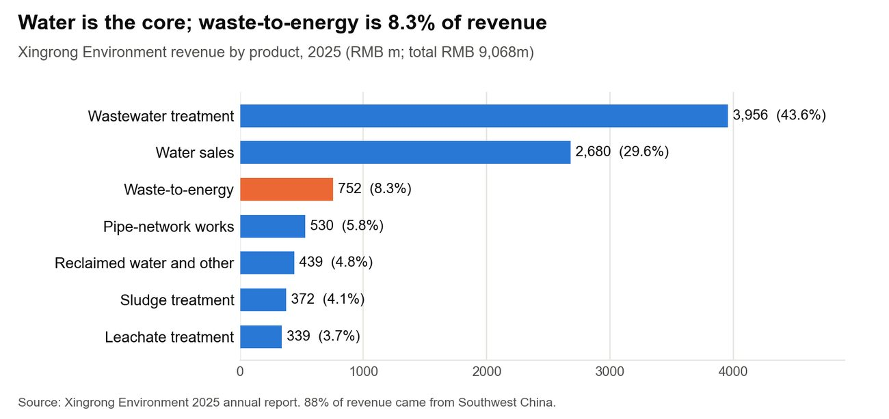

Author: Christine (Kuntong) Jiang作者：江坤彤

::: {.en}
*Report draft 3, 25 Oct 2026. Reference numbers [n] refer to the [Sources](../appendix/sources.qmd) page.*
:::

::: {.zh}
*报告第三稿，2026年10月25日。方括号编号对应[资料来源](../appendix/sources.qmd)页。*
:::

## [1.1 About CDEG]{.en}[1.1 关于成都环境集团]{.zh}

::: {.en}
Chengdu Environment Investment Group (CDEG) is a state-owned enterprise (SOE) owned by the City of Chengdu. It has 135 subsidiaries and about 8,200 staff, and holds a domestic AAA credit rating \[18, 19\] \[Company\]. It controls the listed Xingrong Environment (000598.SZ), whose 2025 revenue was RMB 9.07bn \[20\]. Xingrong figures below are Xingrong's, not the whole group's.

Xingrong runs about 4.4 Mt/d of water supply, 5.0 Mt/d of wastewater treatment and 1.3 Mt/d of reclaimed water, plus 3,116 t/d of sludge and 1,950 t/d of food-waste treatment \[20\]. Its four WtE plants, Wanxing I, II and III and Longfeng, total 12,000 t/d including Wanxing III \[20\]. The wider group also transfers 7,230 t/d of waste and treats about 150,000 t/yr of hazardous waste \[18\].

{fig-alt="Xingrong Environment revenue by product, 2025"}

*Figure 1. Xingrong Environment revenue by product, 2025. Source: \[20\].*

Water is the core business. WtE earned RMB 752m in 2025, 8.3% of revenue, at a 45.6% gross margin, and sold 1,020 GWh of power \[20\]. 88% of Xingrong's revenue came from Southwest China, and its only overseas holding is an associate company in Lahore \[20\]. CDEG has deep operating experience, almost all of it in China.
:::

::: {.zh}
成都环境投资集团（简称“成都环境集团”或“集团”）是成都市属国有企业，拥有135家子公司、约8,200名员工，国内信用评级AAA \[18, 19\] \[企业\]。集团控股上市公司兴蓉环境（000598.SZ），后者2025年营收90.7亿元 \[20\]。以下兴蓉环境的数据仅代表兴蓉环境，不代表整个集团。

兴蓉环境运营约440万吨/日供水、500万吨/日污水处理和130万吨/日再生水，另有3,116吨/日污泥处理和1,950吨/日厨余垃圾处理能力 \[20\]。其四座垃圾焚烧发电厂——万兴一期、二期、三期和隆丰——合计12,000吨/日（含万兴三期）\[20\]。集团整体另有7,230吨/日垃圾转运能力和约15万吨/年危险废物处理能力 \[18\]。

{fig-alt="兴蓉环境2025年分产品营收"}

*图1：兴蓉环境2025年分产品营收。来源：\[20\]。*

水务是核心业务。2025年焚烧发电收入7.52亿元，占营收8.3%，毛利率45.6%，售电10.20亿千瓦时 \[20\]。兴蓉环境88%的营收来自中国西南地区，唯一的境外持股是拉合尔的一家联营公司 \[20\]。集团运营经验深厚，但几乎全部在国内。
:::

## [1.2 What CDEG can and cannot export]{.en}[1.2 集团能输出与不能输出的能力]{.zh}

::: {.en}
CDEG's exportable strength is operating skill. It ran about 6,900 t/d of grate WtE before Wanxing III \[20\]. Xingrong announced on 7 May 2026 that Wanxing III had completed its 72+24-hour full-load trial \[21, 22\]. By August 2026 the plant was feeding the grid, and its tipping fee was still being set \[21\]. CDEG's furnaces co-fire about 10% sludge \[2\]. Wanxing III is designed for 800 t/d of sludge and 800 t/d of food waste \[22\] \[Company\], a design figure rather than an operating record. CDEG states that its flue-gas train meets EU requirements: SNCR, semi-dry and dry scrubbing, activated carbon, baghouse and SCR \[3\] \[Company\]. Its daily emissions are published on China's national disclosure platform \[23\].

Three other assets travel with conditions:

-   The food-waste equipment was built for wet, high-impurity Chinese food waste, so it suits contaminated FOGO and commercial food waste \[18\] \[Inferred\].
-   The NB-IoT ultrasonic meters made by sister company Huijin (Class 2, R160–R400) need NMI approval before trade use in Australia. CDEG reports overseas agent sales but holds no OIML certificate yet \[19, 24\] \[Company\].
-   Drainage-network sensors and the digital platform are commercial in Chengdu and four other cities \[19\] \[Company\].
-   The CCUS line is still at research stage, which fits joint R&D.

Three things do not travel:

-   China's concession-plus-subsidised-power model has no equivalent in Victoria.
-   CDEG does not own furnace technology: it buys its equipment \[25\]. It is willing to offer technology plus O&M and to license technology \[2\], but in WtE what it can sell is operating know-how.
-   CDEG runs no general-waste sorting plant ahead of its furnaces \[2\], which Victoria's rules on recyclables require (2.3, 3.3). A local partner has to supply that step.
:::

::: {.zh}
集团可输出的核心优势是运营能力。万兴三期投产前，集团运营约6,900吨/日的炉排炉焚烧产能 \[20\]。兴蓉环境于2026年5月7日公告万兴三期已完成72+24小时满负荷试运行 \[21, 22\]。截至2026年8月，该厂已并网发电，垃圾处理费仍在核定中 \[21\]。集团焚烧炉掺烧约10%污泥 \[2\]。万兴三期设计处理污泥800吨/日、厨余垃圾800吨/日 \[22\] \[企业\]，这是设计值，而非运行记录。集团称其烟气净化系统满足欧盟要求：SNCR、半干法与干法脱酸、活性炭喷射、布袋除尘和SCR \[3\] \[企业\]。其日均排放数据在国家公开平台发布 \[23\]。

另有几项能力可以有条件地输出：

-   厨余处理设备为含水率高、杂质多的中国厨余垃圾设计，因此适合杂质较多的FOGO（厨余与园林有机垃圾）及商业厨余 \[18\] \[推断\]。
-   姊妹公司汇锦生产的NB-IoT超声波水表（2级，R160–R400）在澳洲用于贸易结算前须取得NMI型式批准。集团称已有海外代理销售，但尚未取得OIML证书 \[19, 24\] \[企业\]。
-   排水管网传感器和数字化平台已在成都及其他四个城市商用 \[19\] \[企业\]。
-   碳捕集利用与封存（CCUS）业务仍处于研究阶段，适合联合研发。

有三项无法输出：

-   中国的“特许经营+电价补贴”模式在维州没有对应机制。
-   集团不拥有焚烧炉技术，设备系外购 \[25\]。集团愿意提供“技术+运营”并进行技术许可 \[2\]，但在焚烧发电领域，集团能出售的是运营诀窍。
-   集团的焚烧厂前端没有一般垃圾分拣设施 \[2\]，而维州关于可回收物的规定要求进行分拣（2.3、3.3）。这一环节须由本地伙伴提供。
:::

## [1.3 Questions this report answers]{.en}[1.3 本报告回答的问题]{.zh}

::: {.en}
These questions are drawn from CDEG's brochure and registration form \[18, 19\] and from our calls of 14 and 15 October \[2, 25\]:

1.  Which rules govern market access, emissions and grid connection? (2.3; Appendix C)
2.  What waste does Australia have, and does it suit CDEG's grates and co-processing? (3.3)
3.  Where are the WtE projects to operate, upgrade or invest in? (3.1; 4.1; 6.1)
4.  Who buys smart water meters, and through which channels? (3.1c; 4.3; 6.4)
5.  Which research partners suit joint R&D on sludge, CCUS and AI for water? (3.1d; 6.4)
6.  Who pays, and how big is the market? (3.2; 3.4)
7.  Who are the competitors, and how have Chinese firms fared in Australia? (5.0)
:::

::: {.zh}
以下问题来自集团的宣传册和报名表 \[18, 19\]，以及我们10月14日和15日的通话 \[2, 25\]：

1.  哪些规则管辖市场准入、排放和并网？（2.3；附录C）
2.  澳洲有哪些垃圾，是否适合集团的炉排炉和协同处置？（3.3）
3.  可以运营、改造或投资哪些焚烧发电项目？（3.1；4.1；6.1）
4.  谁购买智能水表，通过哪些渠道？（3.1c；4.3；6.4）
5.  哪些研究伙伴适合在污泥、CCUS和水务AI方面联合研发？（3.1d；6.4）
6.  谁付费，市场有多大？（3.2；3.4）
7.  竞争对手有哪些，中国企业在澳洲的经历如何？（第5节）
:::

## [1.4 Method]{.en}[1.4 研究方法]{.zh}

::: {.en}
We cover Victoria first and compare NSW, WA, QLD and SA (Appendix B). We use three kinds of evidence:

-   CDEG's own materials, calls and written answers
-   public sources: government, regulator and parliament records, company filings and industry reports
-   team models, published as interactive bilingual pages that work inside mainland China \[26, 27\]. Models 1 and 3 and the meter model are built; Model 2 is in progress:
    -   Model 1: a WtE plant payback model
    -   Model 2: a waste-fit check
    -   Model 3: a council price map

Victoria comes first because it has the most licensed WtE tonnage, a high and rising levy, a state push on organics, and the NexStar network in Melbourne. WA, which has built plants, and NSW, which has designated WtE precincts, are compared in Appendix B. We have not yet interviewed Australian licence holders, utilities or regulators. Key figures carry a reference and, where useful, a label: \[Official\] \[Industry\] \[Company\] \[Inferred\] \[Assumption\] [to verify]{.verify} (Appendix G).
:::

::: {.zh}
我们以维州为重点，并与新南威尔士州（新州）、西澳、昆士兰州（昆州）和南澳进行对比（附录B）。我们使用三类证据：

-   集团自身的资料、通话和书面答复
-   公开资料：政府、监管机构和议会记录，公司公告和行业报告
-   团队模型，以中英双语互动网页形式发布，可在中国大陆正常访问 \[26, 27\]。模型1、模型3和水表模型已建成；模型2正在开发：
    -   模型1：焚烧电厂回收期模型
    -   模型2：垃圾适配性检验
    -   模型3：市政价格地图

以维州为先，是因为维州的焚烧许可量最大、填埋税高且持续上涨、州政府大力推动有机垃圾分类，而且NexStar的网络在墨尔本。已建成电厂的西澳和设有指定焚烧区域的新州在附录B中对比。我们尚未访谈澳洲的许可持有方、水务公司或监管机构。关键数据均注明来源，必要时加注标签：\[官方\] \[行业\] \[企业\] \[推断\] \[假设\] [待核实]{.verify}（附录G）。
:::

## [CDEG asset and KPI sheet]{.en}[集团资产与关键指标]{.zh}

::: {.en}
**Table D1. CDEG facts used in this report and items still pending**

::: tw
| Item | Value | Status and source |
|---|---|---|
| WtE capacity | 12,000 t/d including Wanxing III (about 6,900 t/d before it) | 2025 annual report \[20\] |
| Wanxing III | 5,100 t/d MSW, 800 t/d food waste, 800 t/d sludge; six lines; 72+24-hour full-load trial completed May 2026; on the grid, tipping fee being set; \>900 GWh/yr expected | Trial and grid: half-year report \[21\]; design: supplier release \[22\] \[Company\] |
| Minimum size | Line: 500 t/d (below 250 too small). Project: 1,000–1,500 t/d on two lines | CDEG answers \[2, 3\] |
| Grate design | Design 9,000 kJ/kg; range 4,600–14,000 kJ/kg; load 60–110% | CDEG answer \[3\] |
| WtE revenue 2025 | RMB 752m; gross margin 45.6%; 1,020 GWh sold | 2025 annual report \[20\] |
| Meters | Made by sister company Huijin; Xingrong bought RMB 85.75m of them in 2025; no OIML certificate yet | \[20, 24\] |
| Operating KPIs | Availability, kWh/t, cost/t | Pending from CDEG |
| Raw CEMS data | Hourly and annual averages; dioxin tests | Pending from CDEG |
| Meter price and sales | Ex-works price; overseas customers | Pending from CDEG |
:::
:::

::: {.zh}
**表D1：本报告使用的集团数据及待补充项**

::: tw
| 项目 | 数值 | 状态与来源 |
|---|---|---|
| 焚烧发电产能 | 12,000吨/日，含万兴三期（此前约6,900吨/日） | 2025年年报 \[20\] |
| 万兴三期 | 生活垃圾5,100吨/日、厨余800吨/日、污泥800吨/日；六条线；2026年5月完成72+24小时满负荷试运行；已并网，处理费核定中；预计年发电量超过9亿千瓦时 | 试运行与并网：半年报 \[21\]；设计参数：供应商新闻稿 \[22\] \[企业\] |
| 最小规模 | 单线500吨/日（低于250吨/日过小）；项目两条线共1,000–1,500吨/日 | 集团答复 \[2, 3\] |
| 炉排设计 | 设计热值9,000千焦/千克；适应范围4,600–14,000千焦/千克；负荷60–110% | 集团答复 \[3\] |
| 2025年焚烧发电收入 | 7.52亿元；毛利率45.6%；售电10.20亿千瓦时 | 2025年年报 \[20\] |
| 水表 | 姊妹公司汇锦生产；兴蓉环境2025年采购8,575万元；尚无OIML证书 | \[20, 24\] |
| 运营关键指标 | 可用率、吨垃圾发电量、吨成本 | 待集团提供 |
| 原始CEMS数据 | 小时均值与年均值；二噁英检测 | 待集团提供 |
| 水表价格与销量 | 出厂价；海外客户 | 待集团提供 |
:::
:::
