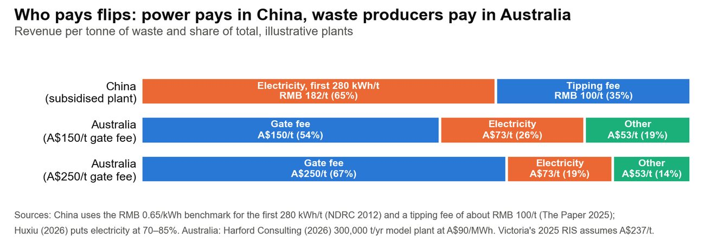

Authors: Kai Marsh (2.1, 2.3) · Christine (Kuntong) Jiang (2.2)作者：马凯（2.1、2.3）· 江坤彤（2.2）

::: {.en}
*Report draft 3, 25 Oct 2026. Reference numbers [n] refer to the [Sources](../appendix/sources.qmd) page.*
:::

::: {.zh}
*报告第三稿，2026年10月25日。方括号编号对应[资料来源](../appendix/sources.qmd)页。*
:::

## [2.1 Victoria's problem and opportunity]{.en}[2.1 维州的问题与机会]{.zh}

::: {.en}
**Victoria makes more burnable waste than its WtE cap can take, landfill gets dearer every year, and the licensed plants will need operators from about 2030.**

**Waste outgrows the cap.** Victoria generated about 15.7 Mt of waste in 2024–25 and sent 5.3 Mt to landfill \[28\] \[Official\]. Of that landfill, 2.41 Mt was burnable household and commercial waste: food, garden, timber, paper, plastics and textiles \[28\]. Victoria's broader residual-waste measure was 5.7 Mt in 2024 and is projected to reach 8.9 Mt by 2053 \[29\]. Melbourne expects to run out of landfill space in the mid-2030s \[29\]. Thermal WtE is capped at 2.5 Mt/yr, raised from 2.0 Mt in July 2025 \[30\], and 2.35 Mt was licensed on 17 August 2025 \[1, 7\]. Even if every licensed plant is built, a large share of residual waste still needs another route \[Inferred\].

**Landfill is priced to lose.** The metropolitan levy has risen from A\$65.90/t in 2019–20 to A\$177.19/t in 2026–27, and it applies in 35 council areas, including Geelong, Ballarat and Bendigo \[4, 31\]. Landfill operators add their own gate fee. We estimate about A\$95/t (range A\$70–130), using Geelong's published waste-charge breakdown \[5\] \[Assumption\]. That makes the metro landfill price WtE must beat about A\$272/t. A WtE plant pays no levy on the waste it burns, although levy applies to any ash it landfills.

**The plants are licensed but not built.** None of the seven cap-licence projects has reached construction. Cleanaway withdrew its EPA application in September 2025 to re-file at 760,000 t/yr \[32\], and its takeover by EQT is due to complete by March 2027 \[33\]. Each owner will need a builder, a technology supplier and an operator (5.1).

**Three streams sit outside the cap.**

-   **Food:** 437,000 t went to landfill in 2024–25 (Table 4). Every household must have FOGO collection by 2030, and the standard four-bin system is due by 1 July 2027, although that deadline was not yet legislated in March 2026 \[34, 35\].
-   **Biosolids:** 167,000 t went to landfill in 2024–25 (Table 4). Biosolids burnt on their own are exempt from the cap \[36\].
-   **Meters:** water meters are replaced on a 10–15-year cycle \[27\].

CDEG already runs all three businesses in Chengdu (1.2).

**Table 1. Victoria's waste, levy and cap at a glance**

::: tw
| Measure | Value | Source |
|---|---|---|
| Waste generated, 2024–25 | 15.7 Mt | \[28\] \[Official\] |
| Burnable waste landfilled, 2024–25 | 2.41 Mt | \[28\] \[Official\] |
| Council kerbside garbage, 2023–24 | 1.11 Mt | \[37\] \[Official\] |
| Thermal WtE cap / licensed (Aug 2025) | 2.5 / 2.35 Mt | \[1, 30\] |
| Metro landfill levy 2026–27 | A\$177.19/t | \[4\] \[Official\] |
| Metro landfill price incl. gate fee | ≈ A\$272/t | \[5\] \[Assumption\] |
:::

**So what for CDEG.** What Victoria lacks is operators, not waste or licences. CDEG cannot win a cap licence, but it can sell the operating skill licence holders will need, and start now in streams that need no cap.
:::

::: {.zh}
**维州产生的可燃垃圾超过焚烧配额所能消纳的量，填埋成本逐年上升，而已获许可的电厂约从2030年起需要运营方。**

**垃圾量超过配额。** 维州2024–25年产生约1,570万吨废物，其中530万吨进入填埋场 \[28\] \[官方\]。填埋量中有241万吨是可燃的生活和工商业垃圾：厨余、园林垃圾、木材、纸张、塑料和纺织品 \[28\]。按维州更宽口径的“剩余垃圾”统计，2024年为570万吨，预计到2053年达到890万吨 \[29\]。墨尔本预计在2030年代中期耗尽填埋空间 \[29\]。热处理焚烧发电的总量上限为每年250万吨（2025年7月由200万吨上调）\[30\]，2025年8月17日已发放235万吨许可 \[1, 7\]。即使所有获许可的电厂全部建成，仍有很大一部分剩余垃圾需要其他去向 \[推断\]。

**填埋的定价就是要让它失去竞争力。** 大都市区填埋税从2019–20年的65.90澳元/吨升至2026–27年的177.19澳元/吨，适用于35个市政区域，包括吉朗、巴拉瑞特和本迪戈 \[4, 31\]。填埋场运营商另收处理费。我们根据吉朗市公布的垃圾费构成，估计约为95澳元/吨（范围70–130澳元）\[5\] \[假设\]。因此，焚烧发电需要击败的大都市填埋价格约为272澳元/吨。焚烧厂焚烧的垃圾不缴纳填埋税，但其填埋的灰渣仍需缴税。

**电厂已获许可，但尚未建设。** 七个配额许可项目均未进入施工阶段。Cleanaway于2025年9月撤回其EPA申请，准备按76万吨/年重新提交 \[32\]；其被EQT收购的交易预计在2027年3月前完成 \[33\]。每个业主都需要一家建设方、一家技术供应商和一家运营方（5.1）。

**三类垃圾流不受配额限制。**

-   **厨余：** 2024–25年有43.7万吨进入填埋（表4）。到2030年所有家庭都必须有FOGO收集服务，标准“四桶”分类系统的截止日期为2027年7月1日，但截至2026年3月该期限尚未立法 \[34, 35\]。
-   **生物固体：** 2024–25年有16.7万吨进入填埋（表4）。单独焚烧的生物固体不受配额限制 \[36\]。
-   **水表：** 水表按10–15年周期更换 \[27\]。

集团在成都已经运营这三类业务（1.2）。

**表1：维州垃圾、填埋税与配额概览**

::: tw
| 指标 | 数值 | 来源 |
|---|---|---|
| 2024–25年废物产生量 | 1,570万吨 | \[28\] \[官方\] |
| 2024–25年填埋的可燃垃圾 | 241万吨 | \[28\] \[官方\] |
| 2023–24年市政路边收集生活垃圾 | 111万吨 | \[37\] \[官方\] |
| 焚烧配额上限 / 已许可（2025年8月） | 250万吨 / 235万吨 | \[1, 30\] |
| 2026–27年大都市填埋税 | 177.19澳元/吨 | \[4\] \[官方\] |
| 大都市填埋价格（含处理费） | 约272澳元/吨 | \[5\] \[假设\] |
:::

**对集团的意义。** 维州缺少的是运营方，而不是垃圾或许可。集团无法取得配额许可，但可以向许可持有方出售他们将来需要的运营能力，并现在就从不需要配额的垃圾流起步。
:::

## [2.2 China's WtE model vs Victoria]{.en}[2.2 中国焚烧模式与维州对比]{.zh}

::: {.en}
**China pays WtE plants through concessions and subsidised power; Victoria pays them through gate fees set against a landfill levy. CDEG can export how it runs plants, not how it is paid.**

In China, local government makes the decisions.

-   **Waste supply:** It grants a 25–30-year BOT or BOO concession, now generally up to 40 years \[20, 38\], and pays a tipping fee per tonne \[20, 39\].
-   **Main revenue:** Electricity earns about two-thirds of revenue. The first 280 kWh per tonne earns a benchmark RMB 0.65/kWh, about RMB 182/t, and the rest earns the local coal-power price \[39, 40\]. The tipping fee, about RMB 100/t, provides the other third \[39\] \[Industry\]. Plants connected since September 2020 share this subsidy with local government, and the central share is being phased out \[41\].
-   **Emissions:** Since 2020, automatic monitoring data can be used as evidence of violations \[42\], and plants publish their data on the MEE's WtE plant monitoring disclosure platform \[23\].
-   **Feedstock and siting:** CDEG's plants do no front-end sorting \[2\]. CDEG's rule of thumb is that a plant should generally be no more than about 50 km from the city it serves \[2\]. In Victoria that is a starting point, not a rule ([WtE siting](../part-a/wte.qmd#siting)).

In Victoria, a private developer must win a cap licence, EPA development and operating licences, and planning approval \[43\] (2.3).

-   **Waste supply:** Council consortia sign long supply contracts. For example, nine south-east metropolitan councils agreed a 25-year waste supply agreement in 2024 \[44\].
-   **Main revenue:** Gate fees carry about 60% of revenue and power about 25% \[45\]. The full revenue stack and our plant model are in [WtE economics](../part-a/wte.qmd#wte-economics).
-   **Emissions:** EPA expects best practice in siting, design and emission control \[46\]. The Maryvale approval ties mercury monitoring to EU best available techniques \[47\].
-   **Feedstock and siting:** Only waste that cannot practicably be recycled may be burnt \[48\]. Sites are decided through planning and are strongly contested (4.4).

{fig-alt="WtE revenue per tonne in China and Australia"}

*Figure 2. WtE revenue per tonne in China and Australia. Sources: \[39, 40, 45\].*

**Why Chinese WtE operators are looking abroad.** These are industry and media estimates, and we have not checked them against company data \[Industry\].

-   China's incineration capacity reached about 1.18 Mt/d at the end of 2025, against a 14th Five-Year Plan target of about 0.8 Mt/d \[49, 50\].
-   Utilisation estimates differ: about 60% on one industry estimate \[39\], against an average load rate of 88.7% in the official count for 2024 \[51\].
-   Power subsidies end after 82,500 hours or 15 years \[52\], and tipping fees have risen from about RMB 60–70/t to about RMB 100/t \[39\].
-   Chinese firms had 79 overseas WtE projects by May 2025 \[39\] and joined 12 more in the first half of 2026 \[53\].

CDEG's own Lahore (Pakistan) and Uzbekistan projects stopped for policy reasons \[2, 54\], which is why this report weighs policy risk heavily (6.7). The other difference is the waste itself. Victorian residual waste is drier and richer, so the question for CDEG is high-heating-value fit, not dewatering ([waste fit](../part-a/wte.qmd#waste-fit)).
:::

::: {.zh}
**中国通过特许经营和电价补贴向焚烧厂付费；维州则通过以填埋税为参照的处理费付费。集团可以输出的是电厂的运营方式，而不是收费方式。**

在中国，由地方政府主导决策。

-   **垃圾供应：** 地方政府授予25–30年的BOT或BOO特许经营权，目前一般可达40年 \[20, 38\]，并按吨支付垃圾处理费 \[20, 39\]。
-   **主要收入：** 售电约占收入的三分之二。每吨垃圾前280千瓦时上网电量享受0.65元/千瓦时的标杆电价，约合182元/吨，其余电量按当地燃煤标杆电价结算 \[39, 40\]。垃圾处理费约100元/吨，占另外三分之一 \[39\] \[行业\]。2020年9月以后并网的项目，补贴由地方政府分担，中央补贴逐步退出 \[41\]。
-   **排放：** 自2020年起，自动监测数据可作为认定违法行为的证据 \[42\]，电厂在生态环境部“生活垃圾焚烧发电厂自动监测数据公开平台”发布数据 \[23\]。
-   **原料与选址：** 集团电厂不做前端分拣 \[2\]。集团的经验是，电厂一般不应距服务城市超过约50公里 \[2\]。在维州，这只是起点，而非规则（[焚烧选址](../part-a/wte.qmd#siting)）。

在维州，私营开发商必须取得配额许可、EPA开发许可和运营许可，以及规划批准 \[43\]（2.3）。

-   **垃圾供应：** 市政联合体签订长期供应合同。例如，墨尔本东南部九个市政于2024年签订了25年的垃圾供应协议 \[44\]。
-   **主要收入：** 处理费约占收入60%，售电约占25% \[45\]。完整的收入构成和我们的电厂模型见[焚烧经济性](../part-a/wte.qmd#wte-economics)。
-   **排放：** EPA要求在选址、设计和排放控制方面采用最佳实践 \[46\]。Maryvale项目的批准将汞监测与欧盟最佳可行技术挂钩 \[47\]。
-   **原料与选址：** 只有无法合理回收的垃圾才能焚烧 \[48\]。选址通过规划程序决定，争议很大（4.4）。

{fig-alt="中国与澳洲焚烧发电每吨收入"}

*图2：中国与澳洲焚烧发电每吨收入。来源：\[39, 40, 45\]。*

**中国焚烧企业为何走向海外。** 以下为行业和媒体估计，我们尚未用企业数据核对 \[行业\]。

-   2025年底中国焚烧处理能力约达118万吨/日，而“十四五”规划目标约为80万吨/日 \[49, 50\]。
-   产能利用率的估计不一：一项行业估计约为60% \[39\]，而2024年官方统计的平均负荷率为88.7% \[51\]。
-   电价补贴在82,500小时或15年后结束 \[52\]，垃圾处理费已从约60–70元/吨升至约100元/吨 \[39\]。
-   截至2025年5月，中国企业已有79个海外焚烧项目 \[39\]，2026年上半年又参与了12个 \[53\]。

集团自己在拉合尔（巴基斯坦）和乌兹别克斯坦的项目都因政策原因中止 \[2, 54\]，因此本报告对政策风险给予较高权重（6.7）。另一个差别在于垃圾本身。维州剩余垃圾更干、热值更高，因此集团面临的是高热值适配问题，而不是脱水问题（[垃圾成分与技术适配](../part-a/wte.qmd#waste-fit)）。
:::

## [2.3 Rules a project must meet]{.en}[2.3 项目须满足的规则]{.zh}

::: {.en}
See [Part B: Approval pathways](../part-b/pathways.qmd).
:::

::: {.zh}
见[B部分：审批路径](../part-b/pathways.qmd)。
:::
